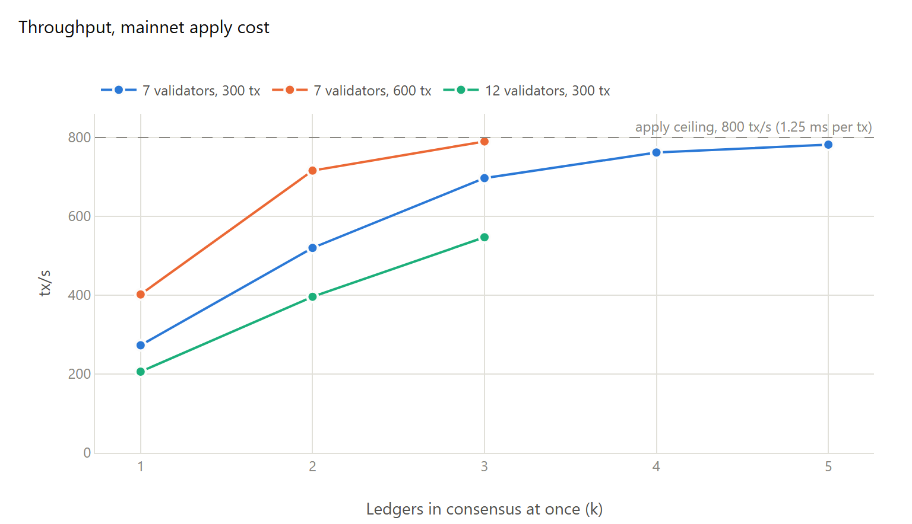
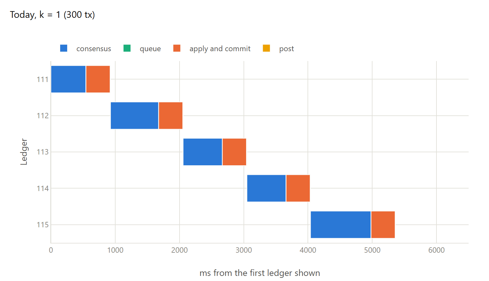
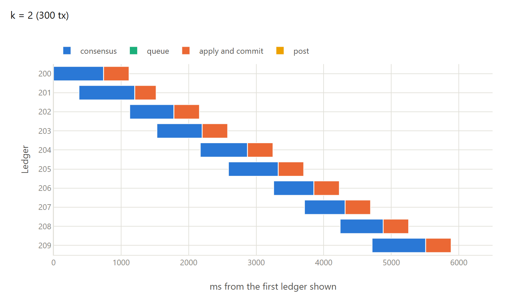
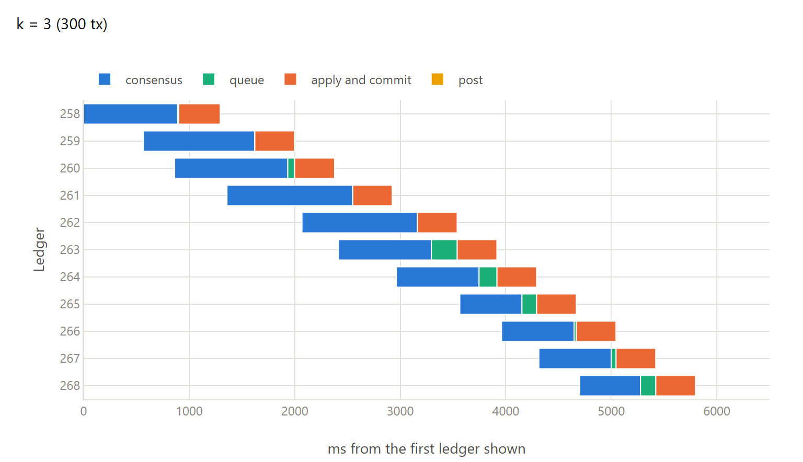

# Pipelining Stellar consensus: k ledgers in consensus at once

Validators could run consensus on several ledgers at the same time, k of them, each one built on
ledger N−k, so that the time spent waiting for messages between continents is used for the next
ledgers. This repository has the measurements, a draft CAP and the testbed. The prototype is the
branch `live-pipelining` of https://github.com/bnogalm/stellar-core (one commit on stellar-core
v30, behind the option `EXPERIMENTAL_LIVE_PIPELINE_DEPTH`).

## Main results

On a WAN testbed of seven validators on four continents, with an apply cost taken from mainnet
(1.25 ms per transaction), 300 transactions per ledger, against the same network without
pipelining:

| k | Ledger interval | Throughput | Median latency |
|---|---|---|---|
| 1 (today) | 1,093 ms | 273 tx/s | 1.30 s |
| 2 | 572 ms | 520 tx/s (1.90×) | 1.41 s (+8%) |
| 3 | 427 ms | 697 tx/s (2.55×) | 1.54 s (+18%) |
| 4 | 390 ms | 762 tx/s (2.79×) | 1.73 s (+32%) |

With twelve validators in four organizations: 1.92× at k = 2 and 2.66× at k = 3.

The ledger cycle on one validator, the same 5 s of each run
([ledger-gantt.md](results/ledger-gantt.md)):

*Today: each ledger starts when the previous one has been applied, a ledger about every 1.1 s.*

*k = 2: two ledgers in consensus at once, and apply overlaps the next one's consensus. A ledger
about every 570 ms.*

*k = 3: ledgers come about as fast as one apply, so some wait to be applied (queue).*

Apply is sequential and sets the ceiling: at 1.25 ms per transaction, about 800 tx/s, whatever k
is. On mainnet, consensus takes about 0.54 s (median, from a watcher node), so against SDF's
planned overlap of consensus and apply, k = 2 would add between 1.15× and 1.55×, and k = 3 between 1.37× and 2.3×, depending on how
fast validators apply.

## What's here

The measurements are in [testbed-results.md](results/testbed-results.md): the k sweep, the target
close time, bigger ledgers and a DoS on the predictable leaders.
[ledger-gantt.md](results/ledger-gantt.md) shows the ledger cycle stage by stage, and
[mainnet-steps.md](results/mainnet-steps.md) has the apply and consensus times measured on
mainnet, which the comparison above is based on.

How it would work as a protocol change is in the
[draft CAP](design/cap-draft-live-pipelining.md), and what it means for safety, liveness and
abuse in the [threat review](design/live-pipelining-threats.md). [testbed/](testbed/) has the
scripts that produced the results, and why the testbed is set up this way.

## Data

`results/data/testbed/` has the summary of every run (per-ledger stage times, throughput,
latency) and the node logs used for the Gantt charts; `results/data/mainnet-watch/` has the
watcher node's logs. `tools/` has the scripts that turn them into the tables and charts.

## License

The text, data and figures are under CC BY 4.0 (see [LICENSE](LICENSE)). The prototype code is
under Apache-2.0, like stellar-core.
