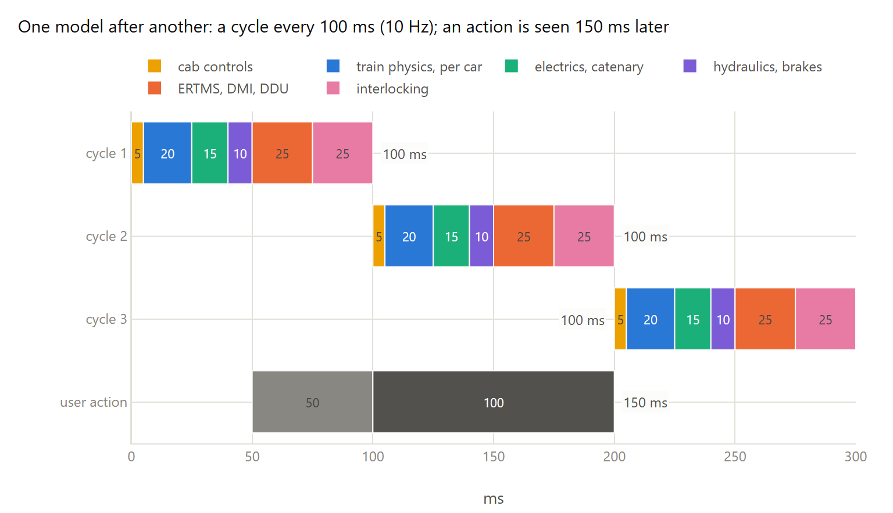
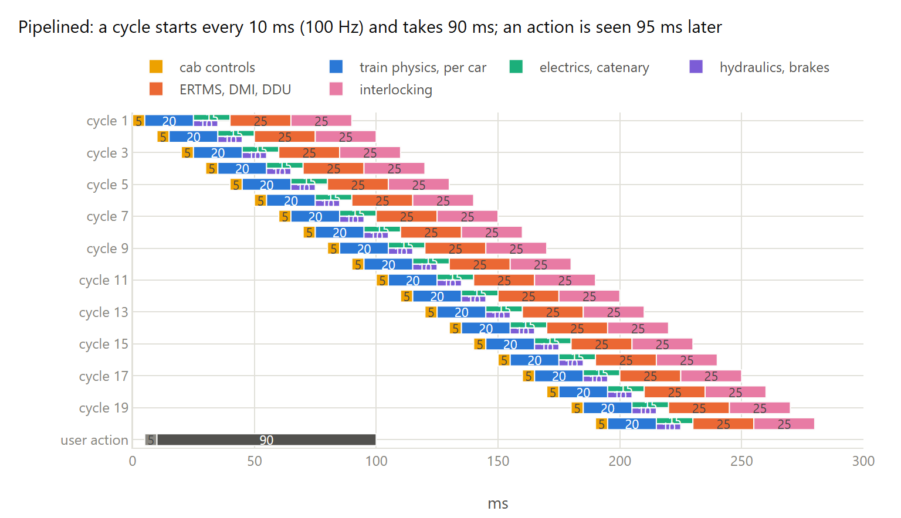
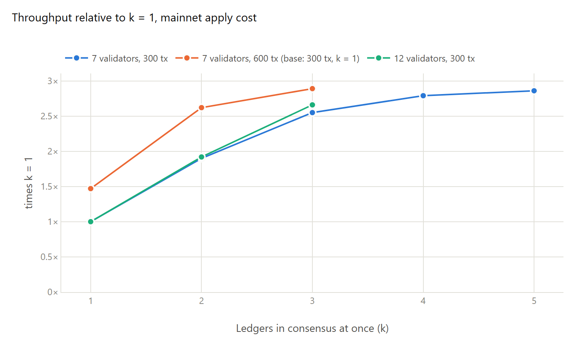
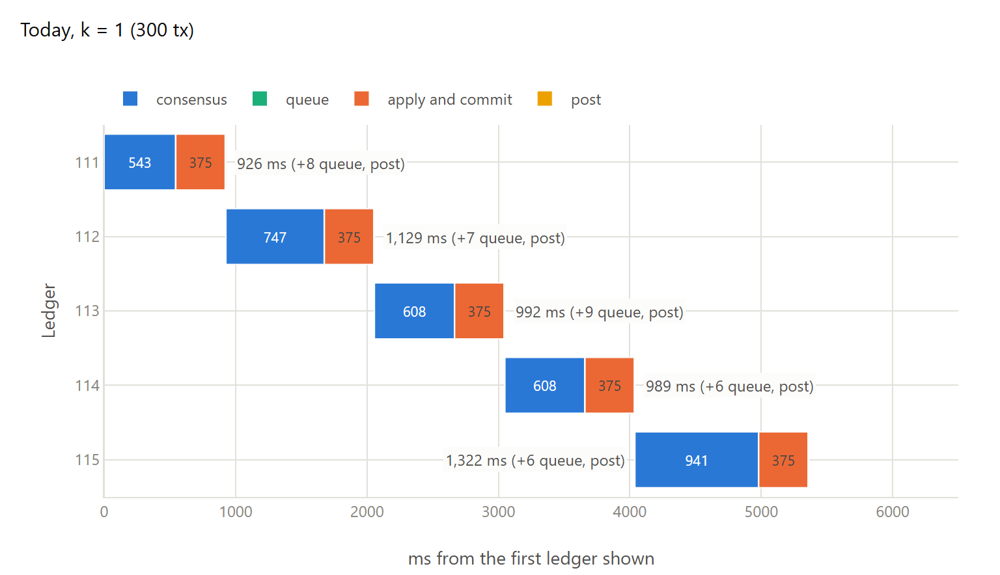
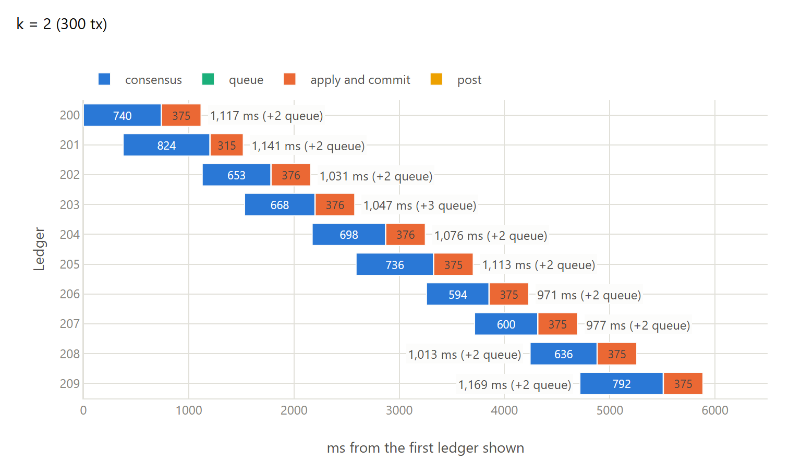
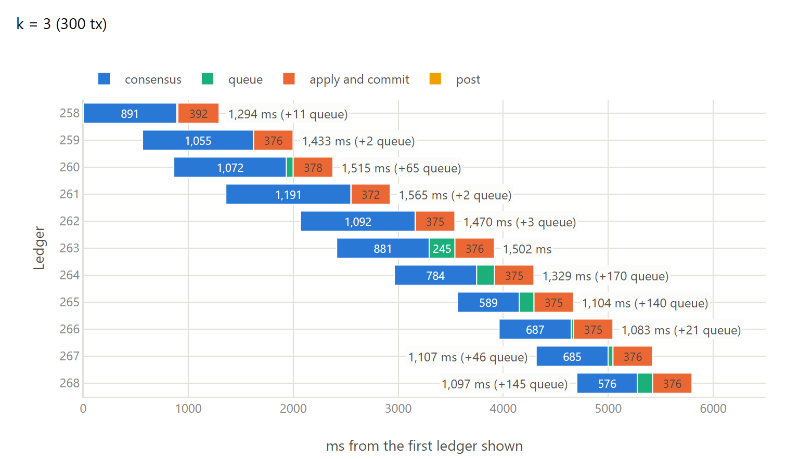
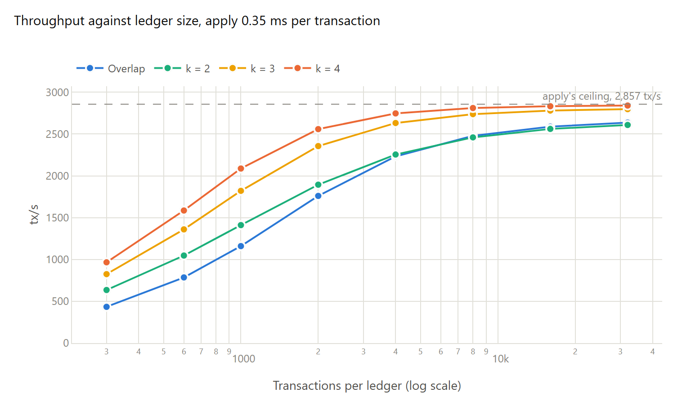

# Pipelining Stellar consensus: k ledgers in consensus at once

Validators could run consensus on several ledgers at the same time, k of them, each one built on
ledger N−k, so that the time spent waiting for messages between continents is used for the next
ledgers. This repository has the measurements, a draft CAP and the testbed.

**In short:**

- **Against today's protocol,** where consensus on a ledger starts once the previous one has been
  applied: on a WAN testbed with mainnet's apply cost and ledgers closing back to back, k = 2
  gives 1.9× the throughput and k = 4 gives 2.8×, for 8% and 32% more median latency for a
  client that pays from one account.
- **Against the overlap of consensus and apply that SDF plans,** the ceiling is the same: one
  transaction per apply time. Pipelining only pays when validators apply a ledger in clearly less
  time than its consensus, ledger size is bounded, and the network needs more than the overlap
  gives (ledgers less than about 0.65 s apart). Then k = 3–4 gives 1.5 to 2× the overlap's
  throughput at the same ledger size. A client with one payer account has more latency than with
  the overlap; a client with a payer account in every class has less, at the same throughput.
- **For mainnet in the medium term,** with ledgers every 2.5 to 5 s, the overlap is enough.
  Pipelining is the step after it.
- **The rules hold together under load:** in 31 rounds with restarts, upgrades and changes of k,
  every validator agreed on every checkpoint.

**Prototype:** the branch `live-pipelining` of https://github.com/bnogalm/stellar-core, on
stellar-core v30. k is a network parameter in the ledger, with a fee reserve, restarts and
catchup, and every rule checked against N−k. With k = 1 it behaves as upstream.

**Discussion:** questions, objections and ideas are welcome in the thread at
https://github.com/orgs/stellar/discussions/2066, so that the debate stays in one place. This
repository is updated from it.

## Where the idea comes from

I have worked on real-time simulators, and among other things I redesigned the core that runs the
models distributed: physics, inputs and outputs run on several machines and have to stay in sync
and refresh with the right data. Some models took 20–30 ms and we needed to run at 100–200 Hz. We
did it with pipelining: start the next cycle before the previous one has finished, and make each
model wait only for the data it reads, so models that don't read each other, like the electrics
and the hydraulics of a train, also run at the same time. An example from a train simulator (the
numbers are only an example, and there were many more models):

Each result took about as long as before, still below what a person can react to, but there were
many more of them per second, so the simulator reacted sooner and ran more smoothly.

A Stellar validator works like the simulator before that change: it starts nominating ledger N
only after applying N−1, and most of the ledger interval is spent waiting for messages between
continents. Running consensus on the next ledgers during that wait is the same idea.

## Against today's protocol

How much does pipelining add to the protocol as it works today? On a WAN testbed of seven
validators on four continents, with an apply cost taken from mainnet (1.25 ms per transaction),
300 transactions per ledger, and a target close time of 200 ms, so that ledgers close back to
back instead of waiting for mainnet's 5 s timer:

| k | Ledger interval | Throughput | Median latency, one payer account |
|---|---|---|---|
| 1 (today) | 1,093 ms | 273 tx/s | 1.30 s |
| 2 | 572 ms | 520 tx/s (1.90×) | 1.41 s (+8%) |
| 3 | 427 ms | 697 tx/s (2.55×) | 1.54 s (+18%) |
| 4 | 390 ms | 762 tx/s (2.79×) | 1.73 s (+32%) |

With twelve validators in four organizations: 1.92× at k = 2 and 2.66× at k = 3.

The ledger cycle on one validator, the same 5 s of each run
([ledger-gantt.md](results/ledger-gantt.md)):

*Today: each ledger starts when the previous one has been applied, a ledger about every 1.1 s.*

*k = 2: two ledgers in consensus at once, and apply overlaps the next one's consensus. A ledger
about every 570 ms.*

*k = 3: ledgers come about as fast as one apply, so some wait to be applied (queue).*

The interval between ledgers follows max(target, (consensus + apply) / k, apply). Apply is
sequential and sets the ceiling: at 1.25 ms per transaction, about 800 tx/s, whatever k is. The
gain stops at k = 4 to 5 here, where the interval reaches the apply time (about 790 tx/s, 2.9×).
With lighter ledgers it goes on further: 3.7× at k = 7 with Soroban calls of 4M instructions
([throughput-current.md](results/throughput-current.md)).

## Against the planned overlap

SDF is working on overlapping the consensus of ledger N+1 with the apply of N
([The road to 5000 TPS](https://stellar.org/blog/developers/the-road-to-5000-tps-scaling-stellar-in-2025)),
so that a ledger closes every max(consensus, apply) instead of their sum. Its
[roadmap](https://stellar.org/foundation/roadmap) calls that step pipelining consensus and
execution; here it is called the overlap, and "pipelining" means k ledgers in consensus at once,
which closes a ledger about every (consensus + apply) / k. The full comparison, measured on the
testbed and simulated with mainnet's consensus times and ledger sizes, is in
[when-pipelining-pays.md](results/when-pipelining-pays.md).

The conditions under which it pays are in the summary above. What the report adds:

*Simulation calibrated on the testbed and mainnet's consensus times, apply 0.35 ms per
transaction. The ceiling is the same for both; pipelining reaches it with smaller ledgers.*

- **At the same ledger size** k = 3–4 gives 1.5 to 2× the overlap's throughput (2.5× measured at
  300 transactions per ledger). The overlap matches it only with ledgers 3 to 4 times larger.
- **The variation of consensus times** costs the overlap about 15% of apply's time at its best
  ledger size. With k = 3–4 other agreed ledgers wait ahead.
- **With ledgers several times larger the choice is open.** The overlap catches up by growing
  ledgers only while a transaction adds more to apply than to consensus, and the measured cases
  fall on both sides
  ([apply-and-consensus-by-size.md](results/apply-and-consensus-by-size.md)).
- **Against mainnet as it runs today,** with a ledger every 5 s and at most 1,000 operations in
  each: about 200 operations per second, against about 1,500 with the overlap run back to back
  and 2,500–3,100 with pipelining at k = 3–4. Demand is about 145.

## Correctness under load

The rules were tested together under load: 31 rounds of ten minutes, with every kind of
transaction (classic operations, fee bumps, SAC, a token, Soroswap), restarts of one and of every
validator, a protocol upgrade and changes of k. In all of them every validator agreed on every
checkpoint, no node stopped and no invariant failed
([correctness-rounds.md](results/correctness-rounds.md)).

## What's here

Results:

- [when-pipelining-pays.md](results/when-pipelining-pays.md): pipelining against the planned
  overlap of consensus and apply.
- [testbed-results.md](results/testbed-results.md): against today's protocol. The k sweep, the
  target close time, bigger ledgers and a DoS on the predictable leaders.
- [throughput-current.md](results/throughput-current.md): throughput against k up to k = 8,
  with light transactions and with the apply cost of mainnet.
- [correctness-rounds.md](results/correctness-rounds.md): the rounds under load, restarts and
  upgrades.
- [ledger-gantt.md](results/ledger-gantt.md): the ledger cycle stage by stage.
- [mainnet-steps.md](results/mainnet-steps.md): the apply and consensus times measured on mainnet.
- [apply-and-consensus-by-size.md](results/apply-and-consensus-by-size.md): what a transaction
  adds to apply and to consensus, and what it changes against the overlap.

Design:

- [Draft CAP](design/cap-draft-live-pipelining.md): how it would work as a protocol change.
- [Threat review](design/live-pipelining-threats.md): what it means for safety, liveness and
  abuse.
- [decisions.md](design/decisions.md): why each part works the way it does, what was left out,
  and what it does not solve.

[testbed/](testbed/) has the scripts that produced the results, and why the testbed is set up
this way.

## Data

- `results/data/testbed/`: the summary of every run against today's protocol (per-ledger stage
  times, throughput, latency) and the node logs used for the Gantt charts.
- `results/data/size-sweep/`: the runs of the comparison with the overlap.
- `results/data/size-apply/`: apply and consensus from 1,000 to 10,000 transactions per ledger,
  the tx set timings, and mainnet replays and a live node.
- `results/data/correctness/`: the checks and results of each correctness round.
- `results/data/mainnet-watch/`: the watcher node's logs.
- `results/data/mainnet-sizes/`: the sizes of 2,000 mainnet ledgers.

`tools/` has the scripts that turn them into the tables and charts, and `tools/sim/` the
simulations.

## License

The text, data and figures are under CC BY 4.0 (see [LICENSE](LICENSE)). The prototype code is
under Apache-2.0, like stellar-core.
