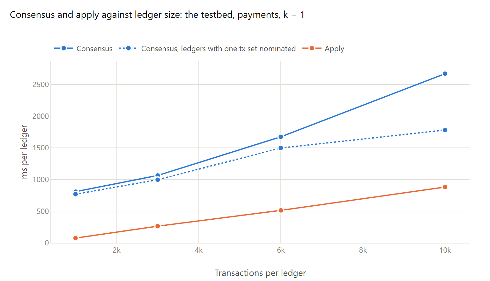

# Apply and consensus against ledger size

Date: 2026-11-17. [when-pipelining-pays.md](when-pipelining-pays.md) compares pipelining with the
overlap of consensus and apply through two lines: the consensus of a ledger of n transactions
takes A + B · n, and its apply F + e · n. This report measures B and e: on the testbed from 1,000
to 10,000 transactions per ledger, and on mainnet's ledgers live and in replay.

## Short answer

- **B = 0.21 ms.** On the testbed consensus took 0.80 s with 1,000 payments per ledger and 2.65 s
  with 10,000. Four fifths of the growth is waiting for whole tx sets to arrive and a fifth is
  CPU. It is the cost of moving tx sets with stellar-core's defaults, not of voting, and it can be
  lowered without changing the protocol.
- **e = 0.09 ms** for those payments. Mainnet's transactions cost more: live on a fast node with
  its state in RAM, 0.35 to 0.48 ms each on average, and each further transaction in a ledger
  added 0.09 ms on one day and 0.31 ms on another.
- **What they decide** ([when-pipelining-pays.md](when-pipelining-pays.md), "e against B"):
  - with today's ledgers apply is well under consensus, and k = 4 gives 1.8 to 2 times the
    overlap's throughput on a fast node;
  - with ledgers several times larger it gives from 1.1 to 2.1 times. The measured e is on both
    sides of B, and neither is known for such ledgers.

## B: consensus per transaction

**Setup:** the WAN testbed of [testbed-results.md](testbed-results.md): seven validators,
inter-region delays with 10 % jitter, 0.1 % loss and 100 Mbit/s per link. One-operation payments
with stellar-core's real apply, k = 1, 240 s of load per size. Target close times of 2, 3, 5 and
8 s, so that the generators can fill the ledgers.

| Per ledger (mean) | 1,000 tx | 3,000 tx | 6,000 tx | 10,000 tx | Fit |
|---|---|---|---|---|---|
| Consensus | 802 ms | 1,050 ms | 1,648 ms | 2,646 ms | 496 ms + 0.208 ms · n |
| Apply | 75 ms | 263 ms | 513 ms | 880 ms | 0.09 ms · n |
| Tx set | 0.2 MB | 0.6 MB | 1.2 MB | 2.0 MB | 200 bytes · n |

*Consensus grows by 0.21 ms per transaction and apply by 0.09 ms. About half of the growth of consensus comes from the ledgers where more than one tx set is nominated (the dotted line leaves them out).*

Where the consensus time goes, per validator, from the trigger of the ledger to its externalize.
The binary is the prototype with four log lines added
([data/size-apply/txsetlog.diff](data/size-apply/txsetlog.diff)):

| Step (mean ms) | 1,000 tx | 3,000 tx | 6,000 tx | 10,000 tx | Fit |
|---|---|---|---|---|---|
| The leader builds the tx set | 32 | 110 | 178 | 306 | 9 + 0.030 · n |
| Until the validator asks for it | 71 | 77 | 108 | 136 | 60 + 0.008 · n |
| Getting it | 231 | 348 | 685 | 1,194 | 67 + 0.109 · n |
| Validating it, waiting included | 33 | 64 | 105 | 129 | 29 + 0.011 · n |
| of which the check itself | 8 | 31 | 54 | 87 | 2 + 0.009 · n |
| From validated to externalize | 442 | 468 | 607 | 915 | 339 + 0.054 · n |
| Total | 808 | 1,063 | 1,673 | 2,669 | 503 + 0.210 · n |
| Total in ledgers with one tx set nominated | 768 | 996 | 1,497 | 1,780 | |
| Tx sets nominated per ledger | 1.5 | 1.6 | 1.7 | 2.2 | |

- **Four fifths of B is waiting for tx sets:** getting the one that wins (0.11 ms per
  transaction), then waiting for the rest of the quorum to have it (0.05 ms). A fifth is CPU on
  the main thread: building a tx set, which every validator does, and checking the one that wins.
- **It comes from how tx sets travel,** with stellar-core's defaults:
  - a tx set travels whole, although validators already have its transactions;
  - a validator waits for every tx set a message names before it processes the message;
  - leaders nominate different tx sets, and every validator fetches each of them: 1.5 per
    ledger with 1,000 transactions. With 10,000 the first one usually needs more than the 1 s of
    a nomination round to reach a quorum, the next round adds leaders, and it is 2.2 per ledger.
    The 21 ledgers of 28 with more than one took 2.97 s, against 1.78 s for the other seven.
- **About half of B is those extra tx sets:** in ledgers with one tx set nominated consensus
  grew from 0.77 s to 1.78 s, 0.11 ms per transaction.
- **It can be lowered without changing the protocol.** Tx sets could travel as references to
  transactions, and upstream has an experimental option to go on with nomination and prepare
  while a tx set downloads (`EXPERIMENTAL_PARALLEL_TX_SET_DOWNLOAD`: off by default and in these
  runs, and only for the next ledger). Either would shorten the overlap's interval, which is the
  consensus time.
- **Whether pipelining overlaps this wait was not measured:** the generators cannot fill large
  ledgers at k > 1. Slots in flight would wait at the same time, but they share the connections
  between validators and the main thread.
- **The main thread limits both arrangements:** on validators it was at 24–30 % with 1,000 to
  1,250 tx/s (10 s samples), so it would saturate at roughly 4,000–5,000 tx/s.

Scripts: `testbed/ksweep.sh`,
[testbed/txset-timings.py](../testbed/txset-timings.py) and, for the chart,
`tools/size-apply-charts.py`. Data:
[data/size-apply/](data/size-apply/), `ksw-pay-k1-tx-n*`. The `ksw-pay-k1-ap-n*` runs are the
same sizes without the log lines: within 4 % up to 6,000 transactions, and 8 % at 10,000.

## e: apply per transaction

One-operation payments on the testbed take 0.09 ms each (table above). Mainnet's ledgers, on a
fast node (Ryzen 7 5800X, database and buckets in RAM):

| Sample | Ledgers | Transactions per ledger | Close per ledger | Fit |
|---|---|---|---|---|
| 1 November, replay | 10,016 | 314 | 151 ms | 76 ms + 0.24 ms · n |
| 8 November, live | 363 | 430 | 149 ms | 112 ms + 0.09 ms · n |
| 17 November, live | 1,152 | 415 | 199 ms | 72 ms + 0.31 ms · n |
| 17 November, replay of the same ledgers | 1,152 | 415 | 222 ms | 70 ms + 0.37 ms · n |

The desktop of [mainnet-steps.md](mainnet-steps.md) replayed the ledgers of 1 November in 402 ms
each: 228 ms + 0.55 ms · n.

- **The mean transaction costs 0.35 to 0.48 ms live** (close per ledger over transactions per
  ledger).
- **A further transaction adds less, and it changes with the day:** 0.09 to 0.31 ms live. Larger
  ledgers carry fewer operations per transaction (2.3 with 200–300 transactions, 1.6 with
  600–800), so the fit's slope is the cost of the transactions that made ledgers larger that day.
- **The fixed part of a ledger is small:** seal, commit and meta take 4, 4 and 5 ms live. The
  76 to 112 ms of the fits are the mix, not a cost per ledger.
- **Live is 10 % faster than replay** on the same ledgers: a live node has checked the signatures
  when the transactions arrived, and a replay checks them inside apply.
- **For ledgers several times today's** this gives 0.1 to 0.5 ms per transaction on a fast node:
  the mean transaction's cost if they fill with today's mix, less if they fill with simpler
  transactions. Parallel apply would lower it.

The live samples are a non-validating node that follows SDF's three validators: two hours on
17 November, and half an hour on 8 November with the prototype, pipelining off. The node of
17 November and the replays run upstream v30 with the per-ledger timing lines of
[data/size-apply/timing.diff](data/size-apply/timing.diff). Script:
[tools/apply-fit.py](../tools/apply-fit.py). Data: [data/size-apply/](data/size-apply/) and,
for 8 November, [data/mainnet-watch/](data/mainnet-watch/) (`live` mode with that log as both
arguments and 141 ledgers skipped).

## Limits

- **B was measured with payments only,** 200 bytes each. Mainnet's transactions carry two
  operations on average and are larger, so what they add to consensus is not known.
- **Ledgers were 2 to 8 s apart** and k was 1: not back to back, and no slots in flight.
- **One host and emulated links:** the eleven nodes share a machine, and real links differ.
- **Live apply is one non-validating node** on two days.
- **Sizes:** mainnet has no ledger above about 1,100 transactions.
