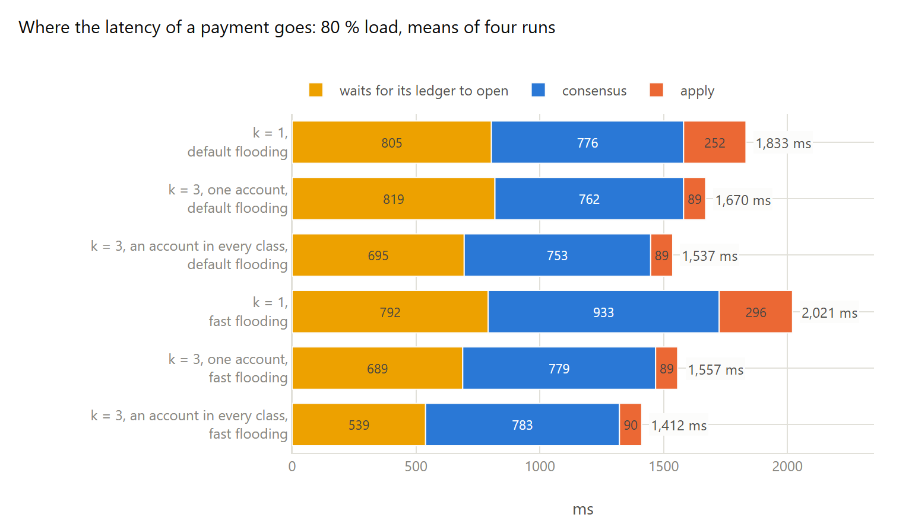
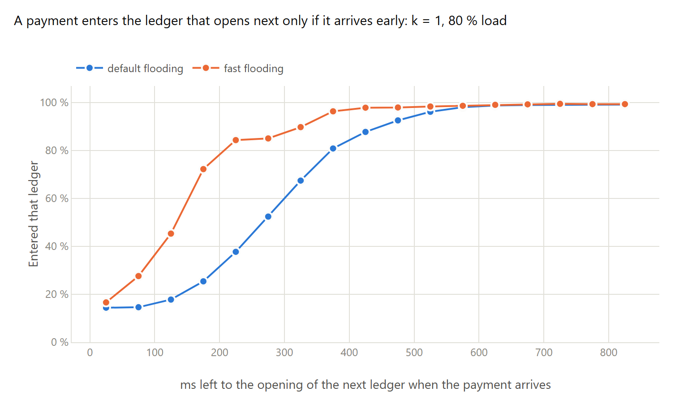
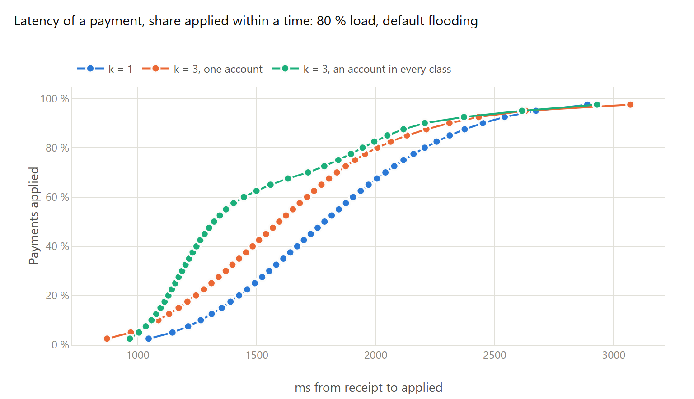
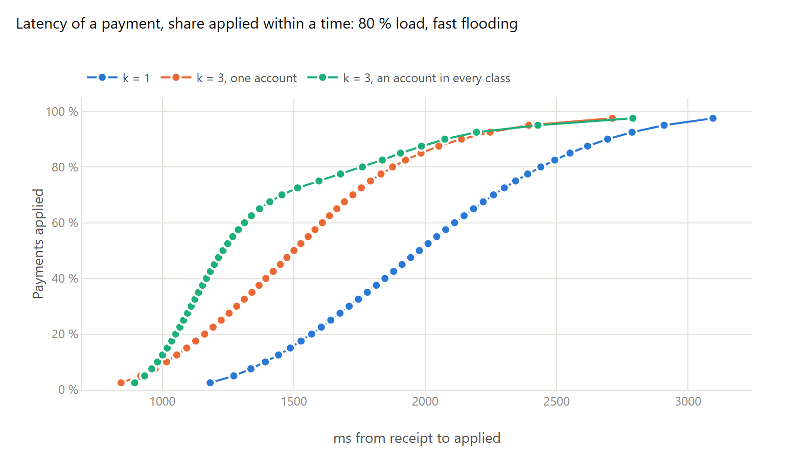

# Latency by pipeline depth, measured

**2026-11-20 to 2026-11-22. Testbed runs, not the simulation.** What a client waits for a payment
with k ledgers in consensus, against today's protocol back to back (k = 1, no 5 s timer).

**The latency is from end to end, and it starts before the ledger does.** A payment arrives at
any moment, waits for a ledger it can enter to open, then for that ledger's consensus and apply.
The wait to enter is 0.5 to 0.8 s here, as much as the consensus, and it is the part pipelining
can shorten.

**The capacity is the same at every k.** A deeper pipeline is used here for latency alone: the
ledgers are made smaller as k grows (1,000, 400, 270 and 210 transactions) so that the network
carries the same transactions per second, 761 to 806 tx/s [measured](#capacity) at every k.
With the ledger size kept instead, pipelining gives more throughput
([when-pipelining-pays.md](when-pipelining-pays.md)); that is not what these runs measure.

## Result

Mean latency of a payment, from its receipt by the validator the client sends it to until its
ledger is applied on that validator, at the same capacity and the same load at every k. Two runs
per cell; each column is compared with its own k = 1.

| | Half load, default flooding | Half load, fast flooding | 80 % load, default flooding | 80 % load, fast flooding |
|---|---|---|---|---|
| **k = 1** | **1,574 ms** | **1,586 ms** | **1,882 ms** | **2,022 ms** |
| k = 3, one account | 1,498 ms (−5 %) | 1,412 ms (−11 %) | 1,663 ms (−12 %) | 1,610 ms (−20 %) |
| k = 3, an account in every class, aiming | 1,378 ms (−12 %) | 1,230 ms (−22 %) | 1,542 ms (−18 %) | 1,384 ms (−32 %) |
| k = 4, one account | 1,546 ms (−2 %) | 1,455 ms (−8 %) | 1,661 ms (−12 %) | 1,616 ms (−20 %) |
| k = 4, an account in every class, aiming | 1,441 ms (−8 %) | 1,230 ms (−22 %) | 1,561 ms (−17 %) | 1,365 ms (−32 %) |

- **A client with a payer account in every class that aims waits less**: 120 to 230 ms less
  than a client with one account at the same k, all of it in the wait for its slot. Its median
  falls by up to 40 % against k = 1; its 90th percentile by 3 to 24 %; its 99th does not fall.
- **A client with one account gains from the smaller ledgers, not from waiting less.** Its wait
  is the same as at k = 1; what falls is the apply (0.35 ms per transaction of a ledger k times
  smaller) and the consensus of k = 1, slower on its larger sets. **With apply at 0.10 ms the
  gain is gone**: at half load k = 3 is 5 % worse than k = 1 with default flooding and equal
  with fast flooding ([below](#the-apply-cost)).
- **The last column overstates the gain.** With fast flooding k = 1 gets worse at 650 tx/s: its
  consensus goes from 776 to 932 ms. Against the better k = 1 (default flooding), k = 3 with
  fast flooding is 15 % less with one account and 23 % less aiming
  ([four runs in one session](#the-80--load-again-in-one-session)).
- **k = 3 and k = 4 are not told apart** by these runs. k = 2 gains less from aiming.

Checked by an independent recomputation from the node logs: the 40 runs of the table come out
within 7 ms.

The full tables, with percentiles and the latency of the other clients, are in [the data](#data).

## Setup

| | |
|---|---|
| Network | 7 validators, emulated WAN (delays of `rtt-7.tsv`, jitter 10 %, loss 0.1 %, 100 Mbit/s) |
| Apply | a pause of 0.35 ms per transaction, the mean cost of a mainnet transaction applied live ([apply-and-consensus-by-size.md](apply-and-consensus-by-size.md)). The payments of the load cost 0.09 ms: their real apply alone would understate it |
| Ledger size | 1,000 / 400 / 270 / 210 transactions for k = 1 / 2 / 3 / 4, chosen so that the capacity is the same at every k (calibrated to 813 tx/s with the slots back to back; 761 to 806 tx/s measured with the cadence below) |
| Load | payments; half load is 406 tx/s, 80 % is 650 tx/s; 240 s per run |
| Clients | 10 % of the load enters at validator 1 and is the group measured; 90 % enters at validators 2, 3 and 4, from one account each, any class |
| Slot cadence | k = 1 back to back; k = 2, 3, 4 a slot every 420, 280, 220 ms |
| Flooding | default: `FLOOD_TX_PERIOD_MS` 200, `FLOOD_ADVERT_PERIOD_MS` 100, `FLOOD_DEMAND_PERIOD_MS` 200; fast: 10, 10, 20 |
| Aiming | the client pays from the account of the class of the first slot its validator expects to open no sooner than a margin: 300 ms with default flooding, 200 ms with fast |

## Where the latency goes

Per transaction, half load, fast flooding (means):

| | Wait: receipt to the opening of its slot | Consensus: opening to externalize | Externalize to applied | Total |
|---|---|---|---|---|
| **k = 1** | 628 ms | 810 ms | 146 ms | 1,586 ms |
| k = 4, one account | 658 ms | 749 ms | 48 ms | 1,455 ms |
| k = 4, aiming | 442 ms (median 328) | 741 ms | 48 ms | 1,230 ms |

The same split at 80 % load:

*Consensus is about half of the latency and does not fall with k. Apply falls with the ledger size. Only the client with an account in every class waits less for its ledger. Fast flooding shortens the wait at k = 3 and lengthens the consensus of k = 1.*

- **Consensus is 700 to 800 ms at k = 2, 3 and 4, and 45 to 140 ms more at k = 1** in three of
  the four settings (up to 940 ms at 80 % load with fast flooding). It is about half of the
  total.
- **Apply falls with k**, the ledgers being smaller: at 80 % load 298 ms at k = 1 against 76 to
  126 ms. With the slower consensus of k = 1, it is all a client with one account gains.
  **It scales with the apply cost, emulated here**, and k = 1 here does not overlap apply with
  the next consensus: it opens the next slot 8 to 27 ms after apply ends. A k = 1 with the
  overlap would take most of this gain away. It is not measured.
- **The wait of a client with one account does not fall.** Its class comes every k slots, which
  at the same capacity is the interval of k = 1.
- **The wait of a client that aims** is

  wait ≈ F + G/2 + p · k·G

  with F the time its transaction needs to reach the validator whose value wins the nomination,
  G the gap between two slots, and p the share of transactions that miss the slot aimed for.
  A miss costs a whole cycle of classes, k·G, the same as at k = 1.

## What makes it work

Each of these was measured by changing it alone.

1. **Slots at a regular cadence.** With the slots back to back, each opens when its base ledger
   (k before) is applied, and the openings come in bursts: at k = 4, 58 % of the gaps were under
   150 ms and 10 % over 384 ms. With a slot every 220 ms, 80 % of the gaps are between 222 and
   239 ms. Without it aiming gives nothing (all the load aiming, fast flooding, k = 4:
   1,437 ms against 1,402 ms with one account; with the cadence 1,289 against 1,425 ms).
   The cost: the client with one account waits 23 to 76 ms more (k = 4 and k = 3), and the
   capacity is 2 to 4 % lower than that of k = 1 ([measured](#capacity)).
2. **Short flooding timers.** A transaction enters a slot only if the validator whose value
   wins had it before opening the slot; the winner is any of the 7 with the same frequency.
   With the default timers the transaction takes 186 to 553 ms (medians) to reach the other
   validators, with the fast ones 39 to 377 ms. The timers are node configuration, sized for
   5 s ledgers. At half load fast flooding leaves k = 1 as it was and takes 86 ms off k = 3 with
   one account and 146 ms off k = 3 aiming. At 80 % load it makes k = 1 worse by 186 ms (four
   runs in one session), which is half or more of what it seems to add there. Its cost in messages is not measured; the
   host CPU goes up by 4 to 10 points.
3. **A short margin.** 200 ms is better than 350 ms at every k (fast flooding, half load, k = 4:
   1,230 against 1,325 ms): covering the farthest validator costs more than it saves.

*With the default timers a payment needs about 450 ms to be in the next ledger nine times in ten; with the fast ones about 300 ms. With less than 100 ms it enters when its own validator's value wins, one slot in 7.*

With the cadence, how many clients aim matters little for the mean: with all the load aiming
the gain at k = 3 is 159 ms, with 10 % of it 181 ms. With all aiming the 99th percentile gets
worse (k = 3: 3,261 to 3,794 ms against 3,023 to 3,143 ms).

A higher fee (the top of the range the other clients pay) cuts the 99th percentile of a client with one account
(about 3,450 to 2,800 ms at 80 % load) and takes 60 to 70 ms off its mean; it adds nothing to
the mean of a client that aims. It does nothing at k = 1.

The clients with one account are not hurt by the ones that aim: at 80 % load with fast flooding
their mean is 1,556 to 1,616 ms with the measured clients aiming against 1,608 to 1,616 ms
without.

## Limits

- **Two runs per cell.** The standard deviation of a run's mean is 30 ms; differences under
  about 60 ms between cells are not established. Within a run, means over 20 s move by up to
  475 ms, with no drift.
- **The columns are different sessions**, and k = 1 moves between sessions by up to 100 ms.
  The 80 % load was run again with both floodings in one session; it gave the same.
- **The apply cost is a pause**, and what a client with one account gains depends on it. A pause
  takes the time and not the CPU; with 7 validators on one host that is the reason to use it.
- **The clients measured sit at the best connected validators** (1 and 2; 3 and 4 are 50 ms
  slower). A transaction is 90 to 450 ms faster when its own validator's value wins, one slot
  in 7 here.
- **Only transactions that entered a ledger are counted**: 97.6 to 99.6 % of those offered, the
  same at every k and client.
- **The estimate the aiming uses starts wrong** (it averages in the 5 s ledgers before the
  load) for the first 9 to 28 s of a run. It works against the client that aims.
- **One testbed:** 7 validators on one host, emulated delays and apply, 240 s runs, load generated
  inside the validators.
- **The cadence is set by hand** to 1.1 times the gap measured back to back. The prototype does
  not choose it.
- **The comparison is with k = 1 back to back, measured.** The overlap of consensus and apply is
  not implemented in this prototype and is not in these tables.
- **The client measured sits at a validator.** A client of Horizon or RPC sees closed ledgers
  only; that case is not measured.
- **Latency ends at apply on the validator**, not when a client learns of it.

## Against the simulation

The simulation of [ledger-gantt.md](ledger-gantt.md#what-a-client-sees) uses the stage times
measured on this testbed and models the client. At the capacity of today back to back, means:

| | Simulation | Measured, 80 % load, default flooding | Measured, fast flooding |
|---|---|---|---|
| **k = 1** | **1.81 s** | **1.83 s** | 2.02 s |
| k = 3, one account | 1.64 s | 1.67 s | 1.56 s |
| k = 3, an account in every class | 1.27 s | 1.54 s | 1.41 s |

- **k = 1 and the client with one account come out as simulated**, within 30 ms.
- **The client with an account in every class gains 0.3 to 0.4 s, not 0.5 s.** The simulation
  lets it enter the next slot always; on the testbed its transaction has to reach the validator
  whose value wins first, and a miss costs k slots.

## Next step: a transaction signed by a payer of every class

The 0.1 to 0.3 s between the simulation and the measure are the misses: a transaction is tied to
the class of its payer when it is signed, and missing its slot costs k slots. Signed by a payer
of every class, it is valid in any slot, and the slot it enters charges the payer of its own
class.

- **A miss costs one slot**, not k: about 0.3 s and not 1 s at k = 3.
- **No aiming**, so no estimate of when the slots open and no margin to choose.
- **It still has to reach the validator whose value wins** before the slot opens. It does not
  enter the next slot always; it enters the first one whose winner has it.
- **What it could give:** the wait of the simulation, about 0.3 s at k = 4 against 0.44 s
  measured aiming (from the recorded times, not measured).
- **What it needs:** a new transaction format, so a protocol change, and that the transaction
  does not enter twice, two slots being in consensus at once:
  - the validator that proposes a slot leaves out what is already in the transaction sets of
    the slots in consensus;
  - ledgers apply in order, and a transaction found a second time at apply is dropped and not
    charged (the sequence number of its source account already stops it from running twice).
- **To measure:** latency, and how many transactions enter twice, with the format implemented
  in the prototype.

## Capacity

Load over the capacity, ledgers full, the sizes and cadence of the table. One run each.

| k | Ledger size | Default flooding | Fast flooding |
|---|---|---|---|
| **1** | 1,000 | **806 tx/s** (a ledger every 1,238 ms) | **784 tx/s** (1,268 ms) |
| 2 | 400 | 771 tx/s (514 ms) | 761 tx/s (524 ms) |
| 3 | 270 | 789 tx/s (339 ms) | 768 tx/s (348 ms) |
| 4 | 210 | 784 tx/s (266 ms) | 778 tx/s (269 ms) |

The capacity is the same at every k within 4 %, and fast flooding takes 1 to 3 % of it. Half
load (406 tx/s) is 50 to 53 % of the capacity at every k, and 650 tx/s is 81 to 85 %: each k
faces the same share.

## The apply cost

The client with one account, half load, apply at 0.10 ms per transaction instead of 0.35. Two
runs.

| k | Flooding | Apply 0.35 ms | Apply 0.10 ms |
|---|---|---|---|
| **1** | default | **1,574 ms** | **1,426 ms** |
| 3 | default | 1,498 ms (−5 %) | 1,500 ms (+5 %) |
| **1** | fast | **1,586 ms** | **1,396 ms** |
| 3 | fast | 1,412 ms (−11 %) | 1,388 ms (−1 %) |

With a cheap apply k = 1 falls by 150 to 190 ms and k = 3 hardly at all, its ledgers being small
already. What is left against k = 3 with default flooding is its longer wait at the regular
cadence (745 against 666 ms).

## The 80 % load again, in one session

Both floodings interleaved, four runs each. Mean (standard deviation of the four) / median /
90th percentile, ms.

| k | Client | Default flooding | Fast flooding |
|---|---|---|---|
| **1** | one account | **1,834 (18) / 1,785 / 2,451** | **2,020 (62) / 1,978 / 2,688** |
| 3 | one account | 1,670 (14) / 1,596 / 2,311 | 1,558 (38) / 1,501 / 2,141 |
| 3 | aiming | 1,538 (40) / 1,321 / 2,235 | 1,412 (44) / 1,232 / 2,080 |

*Default flooding. Half of the payments of the client that aims are applied within 1.32 s, against 1.60 s with one account and 1.79 s at k = 1. Above the 90th percentile the three lines meet.*

*Fast flooding. k = 3 moves left and k = 1 right: half of the payments within 1.23 s aiming, 1.50 s with one account, 1.98 s at k = 1.*

- Against k = 1 with the same flooding: 9 % (one account) and 16 % (aiming) with default
  flooding; 23 % and 30 % with fast.
- Fast flooding makes k = 1 worse by 186 ms here (consensus 932 against 776 ms, apply 296
  against 252 ms) and k = 3 better by 112 to 126 ms.
- Aiming: the median falls by 270 ms, the 90th percentile by 60 to 75 ms, the 99th not at all
  (3,306 to 3,548 ms against 3,173 to 3,558 ms).
- The other clients, at validator 2, with the measured ones aiming: 1,650 and 1,582 ms against
  1,674 and 1,558 ms.

## What is left to gain

Not measured; from the recorded times or from the code.

| Change | Term | What it would give |
|---|---|---|
| The transaction set sent with the nomination | consensus | about 130 ms (a hop model on the recorded times) |
| The 4 to 10 % of slots that take about 1,370 ms: a second nomination round ([below](#the-slow-slots)) | consensus | 40 to 60 ms of mean, and the tail |
| Transactions sent straight to the next leaders | wait | F down to one network trip |
| A transaction signed by a payer of every class ([above](#next-step-a-transaction-signed-by-a-payer-of-every-class)) | wait | a wait of about 320 ms at k = 4 against 442 ms |

## The slow slots

At every k, k = 1 included, 4 to 10 % of the slots take about 1.37 s from opening to externalize
instead of 0.7 s. One run with the SCP logs (k = 1, 80 % load): 8 slow slots in 158, 6 of them
with a second nomination round.

- **The validators do not agree on the leader of the first round.** In SCP's nomination a node
  always counts itself as a candidate, and each of the others by a draw weighted by the quorum
  set (67 % of 7 here). When the node with the highest priority fails the draw, it still
  nominates its own value and the rest follow others. In slot 126, three validators nominated
  their own value and four followed a fourth node's: no value had the 5 votes.
- **The second round starts after the nomination timeout, 1 s.** It adds a leader, the votes
  join and the slot closes about 0.3 s later.
- **It is stellar-core's nomination with this quorum set, not the prototype.** The timeout is a
  network setting (`nominationTimeoutInitialMilliseconds`); with ledgers under a second, 1 s is
  longer than a whole ledger.
- With k > 1 a slow slot also holds back the slots after it, which externalize in order.

## Data

**The client measured** is the 10 % of the load that enters at validator 1. It has either one
payer account, or a payer account in every class and aims (pays from the account of the class
of the slot it expects to open next). **The other clients** are the 90 % of the load, each with
one account; the column shows the ones at validator 2, which is as far from the rest as
validator 1. Mean / median / 90th / 99th percentile, ms; two runs.

**Half load, fast flooding**

| k | Client measured | Its latency | Its wait (median) | The other clients |
|---|---|---|---|---|
| 1 | one account | 1,586 / 1,542 / 2,137 / 2,750 | 628 (608) | 1,589 / 1,546 / 2,141 |
| 2 | one account | 1,405 / 1,379 / 1,873 / 2,532 | 607 (591) | 1,408 / 1,382 / 1,880 |
| 2 | aiming, 200 ms | 1,386 / 1,252 / 1,968 / 3,072 | 542 (446) | 1,496 / 1,438 / 2,059 |
| 2 | aiming, 350 ms | 1,452 / 1,358 / 1,959 / 2,853 | 620 (566) | 1,460 / 1,414 / 2,002 |
| 3 | one account | 1,412 / 1,386 / 1,938 / 2,434 | 616 (595) | 1,412 / 1,387 / 1,938 |
| 3 | aiming, 200 ms | 1,230 / 1,118 / 1,786 / 2,460 | 448 (362) | 1,400 / 1,374 / 1,917 |
| 3 | aiming, 350 ms | 1,368 / 1,264 / 1,853 / 2,680 | 562 (493) | 1,434 / 1,400 / 1,964 |
| 4 | one account | 1,455 / 1,416 / 2,012 / 2,852 | 658 (628) | 1,454 / 1,418 / 2,008 |
| 4 | aiming, 200 ms | 1,230 / 1,082 / 1,818 / 2,556 | 442 (328) | 1,437 / 1,409 / 1,986 |
| 4 | aiming, 350 ms | 1,325 / 1,217 / 1,792 / 2,548 | 522 (446) | 1,454 / 1,421 / 2,012 |

**Half load, default flooding**

| k | Client measured | Its latency | Its wait (median) | The other clients |
|---|---|---|---|---|
| 1 | one account | 1,574 / 1,524 / 2,145 / 2,786 | 712 (682) | 1,573 / 1,526 / 2,137 |
| 2 | one account | 1,508 / 1,470 / 2,049 / 2,788 | 723 (700) | 1,522 / 1,486 / 2,051 |
| 2 | aiming, 300 ms | 1,417 / 1,312 / 1,971 / 2,646 | 638 (556) | 1,504 / 1,479 / 1,986 |
| 3 | one account | 1,498 / 1,466 / 2,024 / 2,788 | 737 (710) | 1,502 / 1,469 / 2,031 |
| 3 | aiming, 300 ms | 1,378 / 1,218 / 1,958 / 2,770 | 610 (480) | 1,498 / 1,460 / 2,024 |
| 4 | one account | 1,546 / 1,517 / 2,120 / 2,753 | 772 (750) | 1,542 / 1,512 / 2,112 |
| 4 | aiming, 300 ms | 1,441 / 1,254 / 2,097 / 2,898 | 656 (450) | 1,580 / 1,537 / 2,168 |

**80 % load, fast flooding**

| k | Client measured | Its latency | Its wait (median) | The other clients |
|---|---|---|---|---|
| 1 | one account | 2,022 / 1,974 / 2,678 / 3,537 | 792 (758) | 2,026 / 1,980 / 2,676 |
| 1 | one account, top fee | 2,030 / 1,994 / 2,666 / 3,410 | 792 (772) | 2,017 / 1,976 / 2,642 |
| 2 | one account | 1,616 / 1,546 / 2,205 / 3,500 | 698 (642) | 1,616 / 1,552 / 2,200 |
| 2 | one account, top fee | 1,578 / 1,544 / 2,122 / 2,738 | 666 (640) | 1,620 / 1,561 / 2,189 |
| 2 | aiming | 1,506 / 1,384 / 2,100 / 3,190 | 585 (476) | 1,616 / 1,570 / 2,178 |
| 2 | aiming, top fee | 1,482 / 1,366 / 2,080 / 2,993 | 552 (466) | 1,646 / 1,570 / 2,250 |
| 3 | one account | 1,610 / 1,540 / 2,244 / 3,443 | 722 (662) | 1,608 / 1,537 / 2,234 |
| 3 | one account, top fee | 1,540 / 1,498 / 2,112 / 2,824 | 668 (634) | 1,585 / 1,520 / 2,198 |
| 3 | aiming | 1,384 / 1,218 / 2,030 / 3,208 | 520 (378) | 1,556 / 1,498 / 2,134 |
| 3 | aiming, top fee | 1,351 / 1,214 / 1,948 / 2,761 | 488 (374) | 1,574 / 1,506 / 2,176 |
| 4 | one account | 1,616 / 1,536 / 2,258 / 3,647 | 741 (670) | 1,616 / 1,538 / 2,249 |
| 4 | one account, top fee | 1,558 / 1,522 / 2,134 / 2,839 | 688 (663) | 1,604 / 1,536 / 2,210 |
| 4 | aiming | 1,365 / 1,176 / 2,046 / 3,076 | 514 (341) | 1,570 / 1,518 / 2,145 |
| 4 | aiming, top fee | 1,369 / 1,198 / 2,010 / 2,728 | 497 (339) | 1,652 / 1,570 / 2,308 |

**80 % load, default flooding**

| k | Client measured | Its latency | Its wait (median) | The other clients |
|---|---|---|---|---|
| 1 | one account | 1,882 / 1,820 / 2,540 / 3,423 | 827 (786) | 1,864 / 1,813 / 2,483 |
| 2 | one account | 1,665 / 1,606 / 2,250 / 3,421 | 792 (744) | 1,672 / 1,612 / 2,259 |
| 2 | aiming, 300 ms | 1,560 / 1,420 / 2,152 / 3,224 | 690 (575) | 1,656 / 1,604 / 2,224 |
| 3 | one account | 1,663 / 1,596 / 2,281 / 3,477 | 815 (758) | 1,660 / 1,597 / 2,274 |
| 3 | aiming, 300 ms | 1,542 / 1,324 / 2,233 / 3,494 | 704 (502) | 1,649 / 1,585 / 2,260 |
| 4 | one account | 1,661 / 1,601 / 2,260 / 3,492 | 832 (778) | 1,663 / 1,606 / 2,258 |
| 4 | aiming, 300 ms | 1,561 / 1,326 / 2,318 / 3,670 | 730 (464) | 1,671 / 1,606 / 2,298 |

**To reproduce.** Prototype: the branch `live-pipelining` (load generator options `classmargin`,
`stepms`, `minfeerate`; `Herder::pipelineSlotForNewTx`). Series: `testbed/latency/225-latency-mix.sh`
(half load, fast flooding), `226-latency-mix2.sh` (the other three; the fourth with
`LAT_POINTS`) and `228-latency-checks.sh` (capacity, apply at 0.10 ms, the 80 % load in one
session), on the testbed of `testbed/`. Analysis: `testbed/latency/mix-lat.py` (latency
by origin), `mix-table.py`, and `mix-quantiles.py` with `latency-charts.py` for the charts. The
run with the SCP logs is `232-scp-trace.sh`, read with `scp-trace.py`. Logs of the series: `results/data/latency/`. The earlier series
(all the load at one validator, with and without the regular cadence) are
`223-latency-reps3.sh` and `224-latency-cadence.sh`.
