# The ledger cycle as a Gantt chart

Where does the time of each ledger go on a validator, and what changes with k? The charts have
one row per ledger and one bar per stage, measured on validator 1 of the seven-validator testbed
([testbed-results.md](testbed-results.md)): payments, links with 10% jitter, 0.1% loss and
100 Mbit/s, a 200 ms target close time, and apply stretched to the mainnet cost of 1.25 ms per
transaction. Every chart shows the same 5 s from the middle of a run, so the number of ledgers
that start in it can be compared.

**A ledger's cycle is not the whole latency of a transaction.** These rows start when a ledger
opens. A transaction arrives at any moment and first waits for a ledger it can enter; that wait
is part of its latency from end to end, and with ledgers this short it is as long as the
consensus. It is in [What a client sees](#what-a-client-sees) below, and measured in
[latency-by-depth.md](latency-by-depth.md).

The stages: **consensus** from the moment the validator starts nominating the ledger to
externalize; **queue**, waiting for the previous ledger to finish applying; **apply and commit**;
and **post**, completion on the main thread until the next ledger is armed (without pipelining).

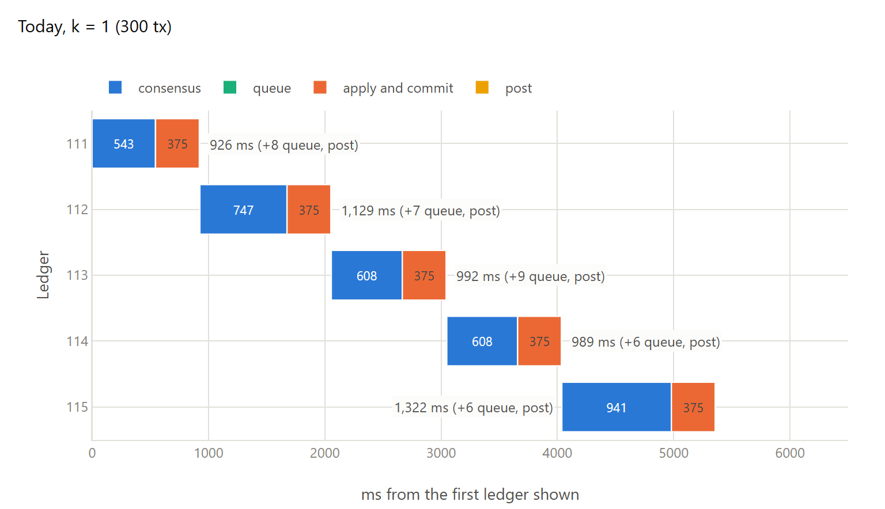

*Today: each ledger starts when the previous one has been applied, so a ledger every consensus + apply, about 1.1 s. 273 tx/s.*

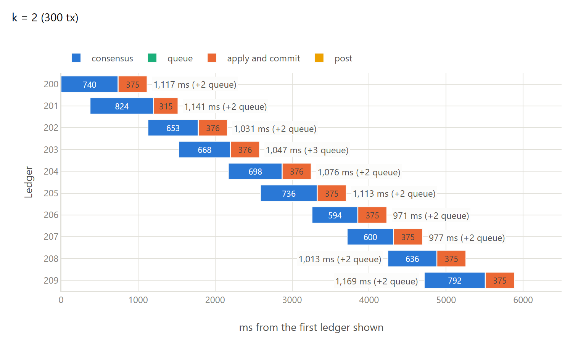

*k = 2: a ledger starts while the previous one is still in consensus, so two are in consensus at once and apply overlaps the next one's consensus. A ledger about every 570 ms, 520 tx/s.*

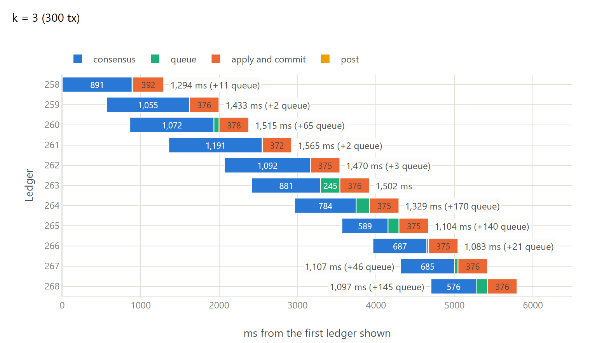

*k = 3: ledgers now come about as fast as one apply (about 375 ms), so some wait to be applied (queue). 697 tx/s.*

And with ledgers twice as big, without pipelining and with k = 2:

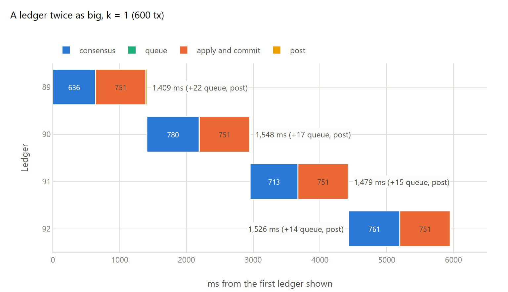

*A ledger twice as big without pipelining: apply doubles too and adds to the interval. 402 tx/s.*

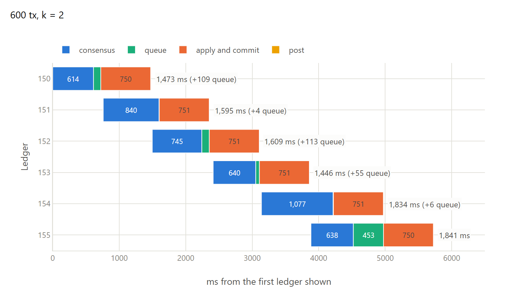

*600 transactions with k = 2: apply (about 745 ms) is close to the interval, so it is the limit. 716 tx/s.*

## What a client sees

The charts above are the validator's view. For a client the question is how long a payment takes
from the moment it has it to the moment it is applied: the wait for a ledger it can enter, then
that ledger's consensus, queue and apply. These charts are not measurements: every bar is
the mean of the simulation of [when-pipelining-pays.md](when-pipelining-pays.md), with apply at
0.35 ms per transaction and the same 5.6 s in each.

The overlap of consensus and apply, with ledgers of 1,000 transactions:

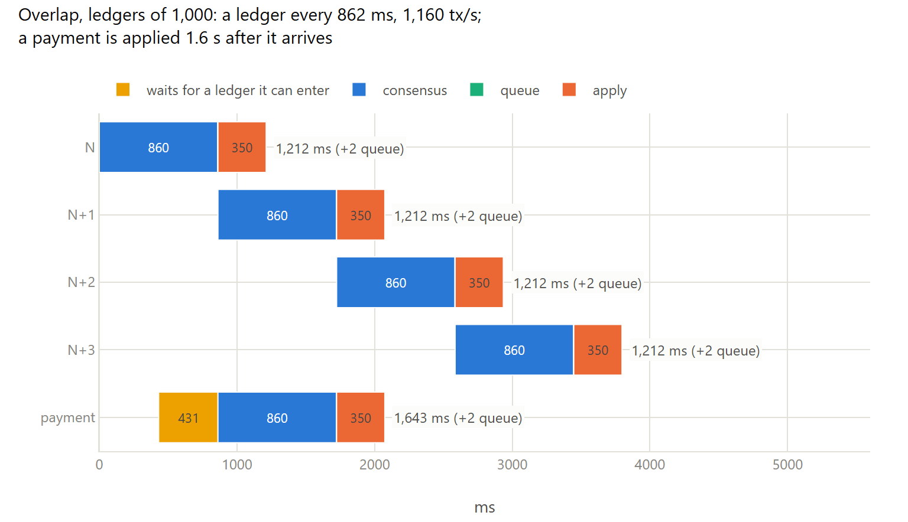

*The overlap: the next consensus runs while a ledger is applied. A payment waits half an interval for the next ledger, 0.43 s, and is applied 1.6 s after it arrives. About 1,160 tx/s.*

The same capacity can be split over smaller ledgers, for latency alone. With k = 3, ledgers of
475 give the throughput of the chart above:

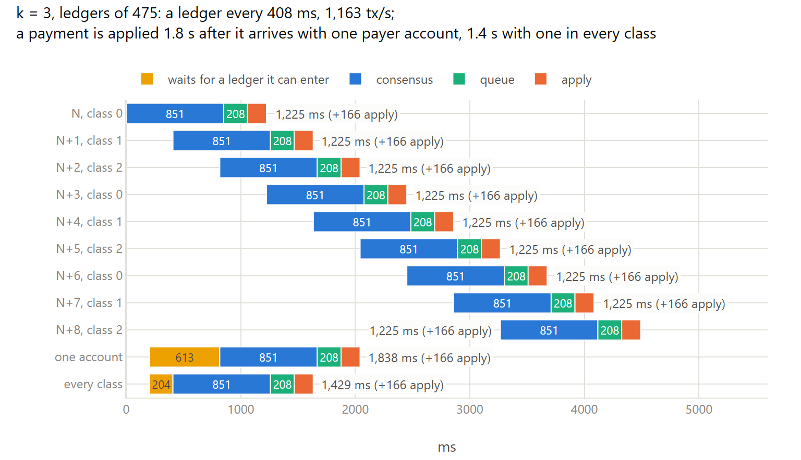

*k = 3 with ledgers of 475: the same 1,160 tx/s, a ledger every 0.41 s. A payment with a payer account in every class is applied 1.4 s after it arrives, 0.2 s sooner than with the overlap; with one payer account, 1.8 s, 0.2 s later.*

The same capacity in smaller ledgers, with the ledger size that keeps the throughput:

| Against | k | Tx per ledger | A ledger every | One payer account | An account in every class |
|---|---|---|---|---|---|
| The overlap, 1,000 per ledger: 1,160 tx/s, 1.64 s | 2 | 705 | 608 ms | 1.83 s | 1.52 s |
| | 3 | 475 | 408 ms | 1.84 s | 1.43 s |
| | 4 | 380 | 328 ms | 1.97 s | 1.48 s |
| Today back to back, 1,000 per ledger: 827 tx/s, 1.81 s | 2 | 425 | 514 ms | 1.54 s | 1.29 s |
| | 3 | 300 | 363 ms | 1.64 s | 1.27 s |
| | 4 | 245 | 299 ms | 1.79 s | 1.34 s |

- **For latency alone the gain is small against the overlap:** 0.1 to 0.2 s, and only with a
  payer account in every class. Against today's protocol back to back it is about 0.5 s.
  **Measured, it is 0.3 to 0.4 s** ([latency-by-depth.md](latency-by-depth.md#against-the-simulation)):
  k = 1 and the client with one account come out as here, and the one with an account in every
  class misses the ledger it aims for part of the time.
- **k = 2 or 3 is enough.** Most of the latency is the consensus of the ledger, and 620 ms of it
  do not depend on the ledger size; what shrinks is the wait and the apply. Past k = 3 the queue
  of agreed ledgers grows by more than the wait shrinks (in the simulation, which is on the high
  side for the queue).
- **The ledgers are not k times smaller.** The same capacity with k = 4 takes ledgers of 380, not
  250: with 250 the interval does not go down to a quarter and the throughput is 830 tx/s.

To double that throughput the overlap needs ledgers four times larger. Consensus and apply grow
with them, and so do the wait and the latency:

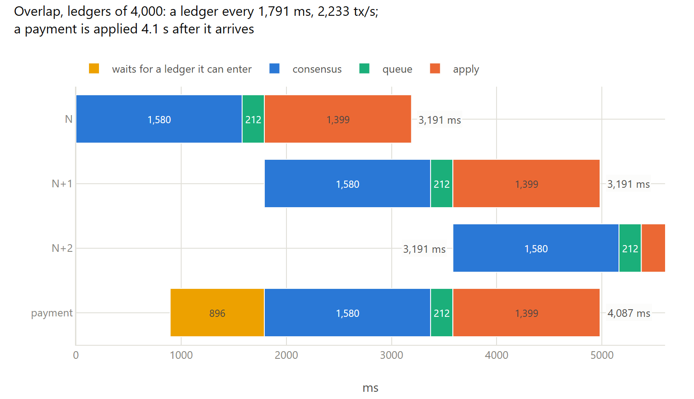

*The overlap with ledgers of 4,000: about 2,230 tx/s, a ledger every 1.8 s, and a payment applied 4.1 s after it arrives.*

Pipelining with k = 4 gets about that throughput with ledgers of 1,000. Four
ledgers are in consensus at once and one starts every 0.48 s. A transaction enters only the
ledgers of its fee payer's class, one in four:

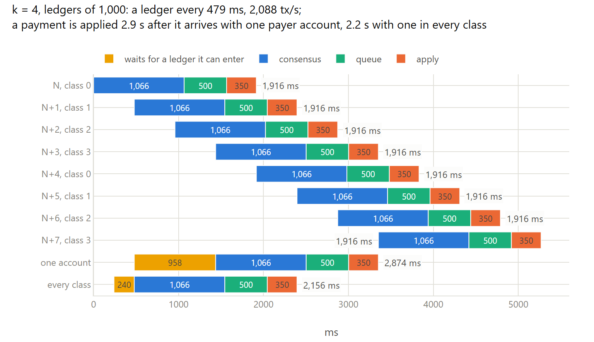

*k = 4 with ledgers of 1,000: about 2,090 tx/s. The last two rows are a payment. With one payer account (of class 3 here) it waits for the ledger of its class, two intervals on average, and is applied 2.9 s after it arrives. With a payer account in every class it enters the next ledger, half an interval away, and is applied in 2.2 s.*

- **One payer account:** the ledger of its class comes every four, so the wait is two intervals
  on average, 0.96 s. That is about what the overlap makes it wait for a ledger of the same
  throughput (0.90 s); the gain is that the ledger is four times smaller, so its consensus and
  its apply are shorter.
- **A payer account in every class:** a payment processor, an exchange with channel accounts, or
  a sponsor that pays the fee with a fee bump. The class of a ledger is known from its number, so
  the client signs with the account whose class is that of the next ledger and waits half an
  interval, 0.24 s.
- **The queue is on the high side.** The simulation draws each consensus time on its own and
  gets 0.5 s of queue at k = 4; on the testbed it was 0.04 s with 300 transactions per ledger.
- **Against the first chart** this one is 0.5 s slower with an account in every class and 1.2 s
  with one. It is the choice when the throughput is needed: the comparison is with the overlap
  at 4,000 per ledger.

## The simulator example

An illustration, not a measurement: the models of a distributed train simulator like the one
mentioned in the discussion post (physics, inputs and outputs on several machines). It had many
more models than these groups, and the times are only examples.

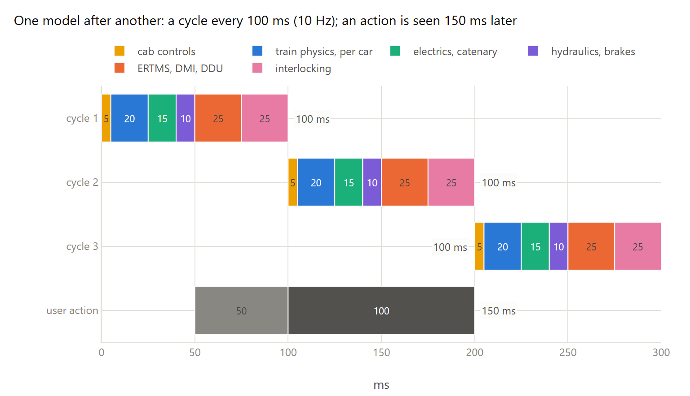

*Each model waits for the previous one: a cycle every 100 ms. Something the user does (last row; grey while it waits, dark while the cycle runs) waits 50 ms on average for the next cycle to read it, and is seen when that cycle ends: 150 ms.*

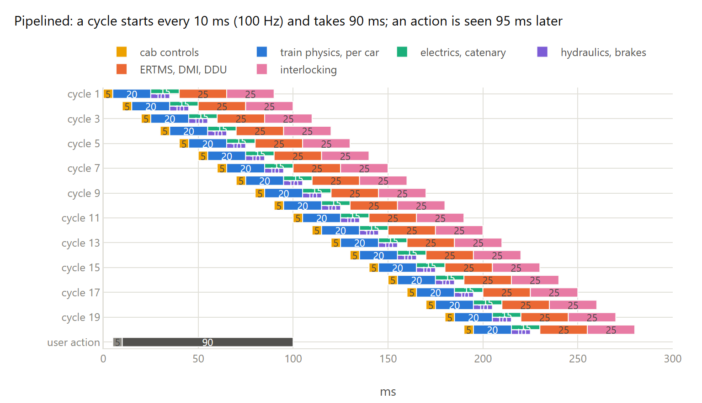

*A clock starts a cycle every 10 ms and each model only waits for the data it reads: a result every 10 ms. The electrics and the hydraulics don't read each other, so they run side by side (two lanes in a row) and a cycle takes 90 ms instead of 100. A cycle starts at most 10 ms after the user acts, so the result is seen 95 ms later on average instead of 150.*

Data: [data/testbed/gantt](data/testbed/gantt) (node 1 logs). Generated by `tools/gantt-charts.py`,
`tools/client-gantt.py` and `tools/simulator-gantt.py`.
