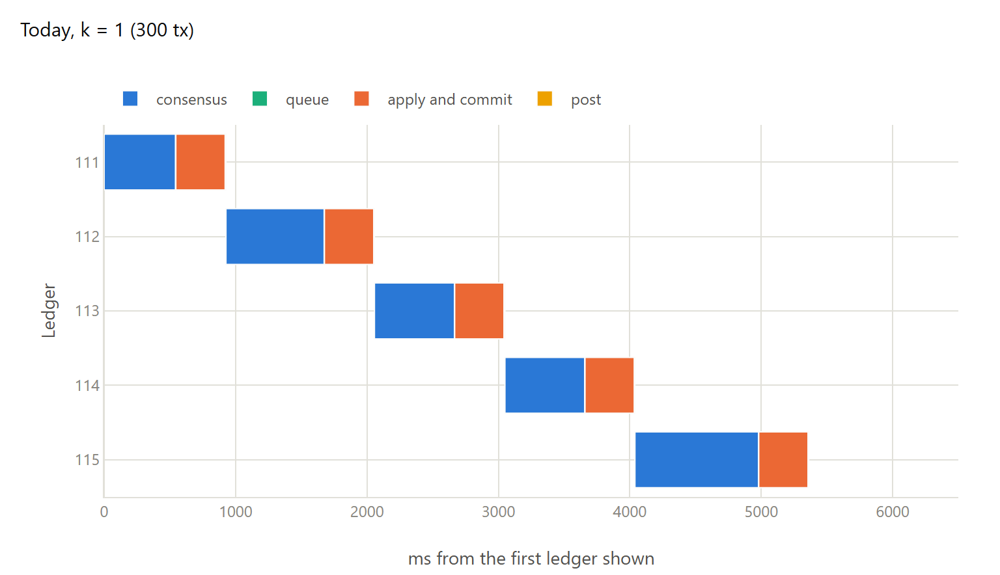
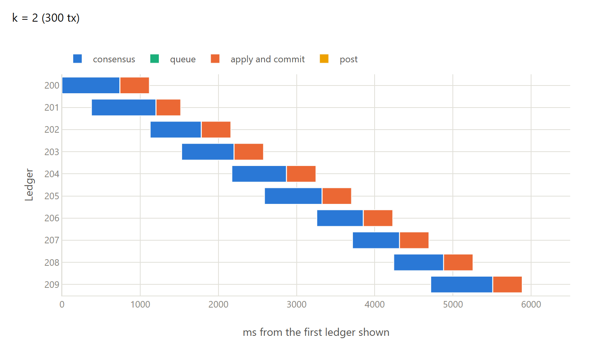
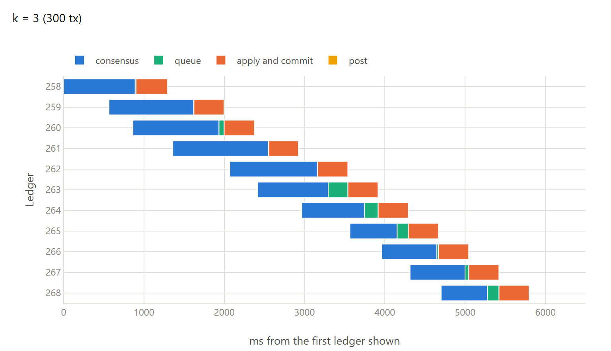
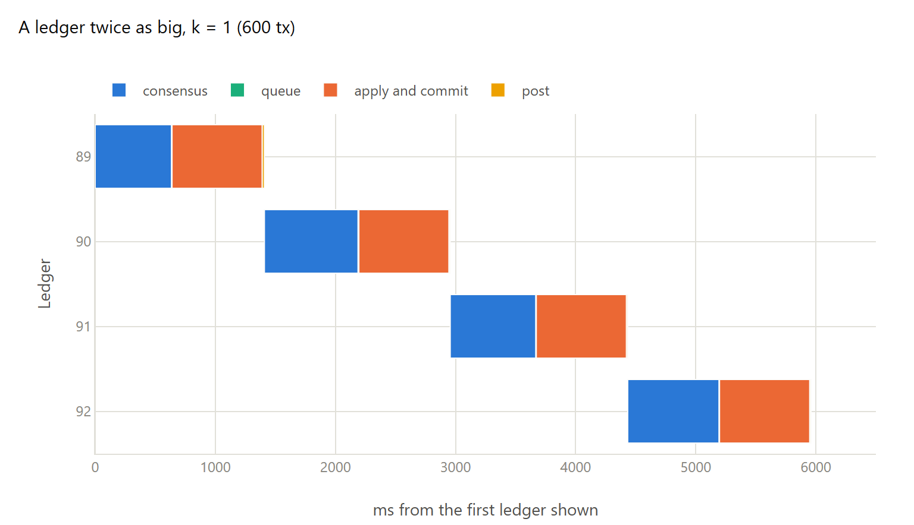
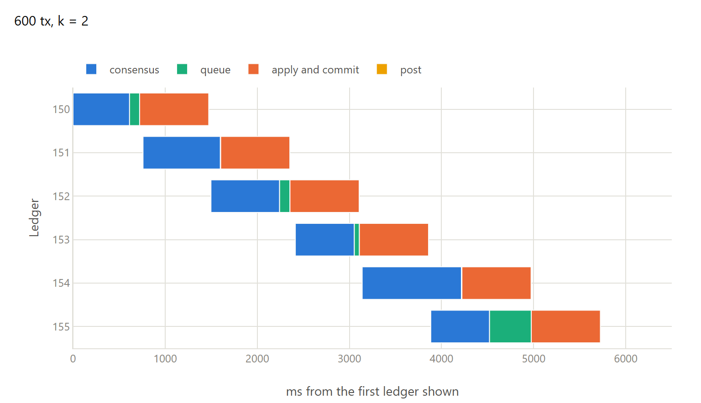
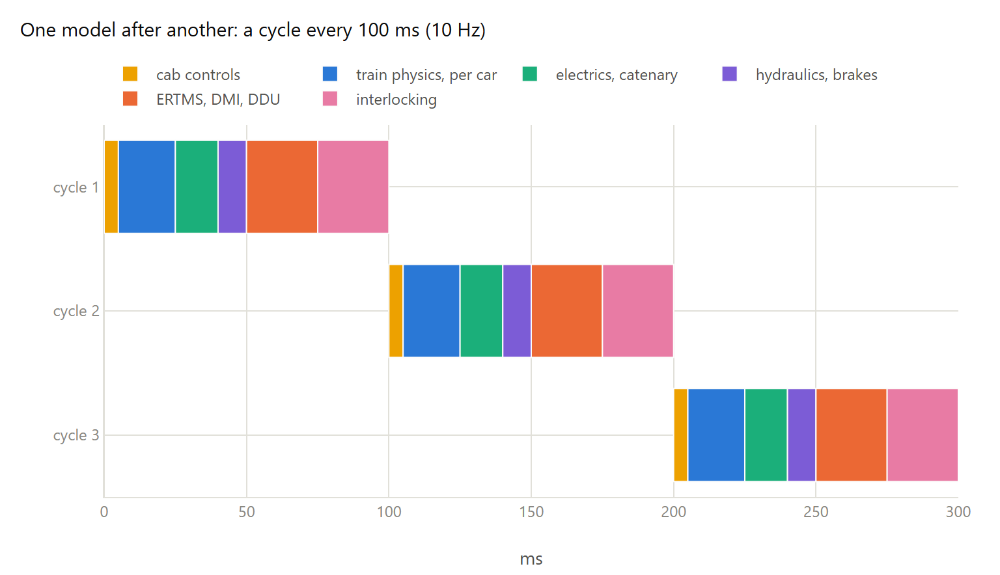
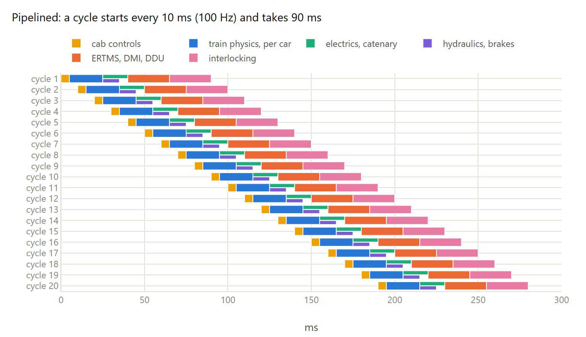

# The ledger cycle as a Gantt chart

One row per ledger, one bar per stage, measured on validator 1 of the seven-validator testbed
([testbed-results.md](testbed-results.md)): payments, links with 10% jitter, 0.1% loss and
100 Mbit/s, a 200 ms target close time, and apply stretched to the mainnet cost of 1.25 ms per
transaction. Every chart shows the same 5 s from the middle of a run, so the number of ledgers
that start in it can be compared.

The stages: **consensus** from the moment the validator starts nominating the ledger to
externalize; **queue**, waiting for the previous ledger to finish applying; **apply and commit**;
and **post**, completion on the main thread until the next ledger is armed (without pipelining).

*Today: each ledger starts when the previous one has been applied, so a ledger every consensus + apply, about 1.1 s. 273 tx/s.*

*k = 2: a ledger starts while the previous one is still in consensus, so two are in consensus at once and apply overlaps the next one's consensus. A ledger about every 570 ms, 520 tx/s.*

*k = 3: ledgers now come about as fast as one apply (about 375 ms), so some wait to be applied (queue). 697 tx/s.*

*A ledger twice as big without pipelining: apply doubles too and adds to the interval. 402 tx/s.*

*600 transactions with k = 2: apply (about 745 ms) is close to the interval, so it is the limit. 716 tx/s.*

## The simulator example

An illustration, not a measurement: the models of a distributed train simulator like the one
mentioned in the discussion post (physics, inputs and outputs on several machines). It had many
more models than these groups, and the times are only examples.

*Each model waits for the previous one: a cycle every 100 ms.*

*A clock starts a cycle every 10 ms and each model only waits for the data it reads: a result every 10 ms. The electrics and the hydraulics don't read each other, so they run side by side (two lanes in a row) and a cycle takes 90 ms instead of 100.*

Data: [data/testbed/gantt](data/testbed/gantt) (node 1 logs). Generated by `tools/gantt-charts.py`
and `tools/simulator-gantt.py`.
