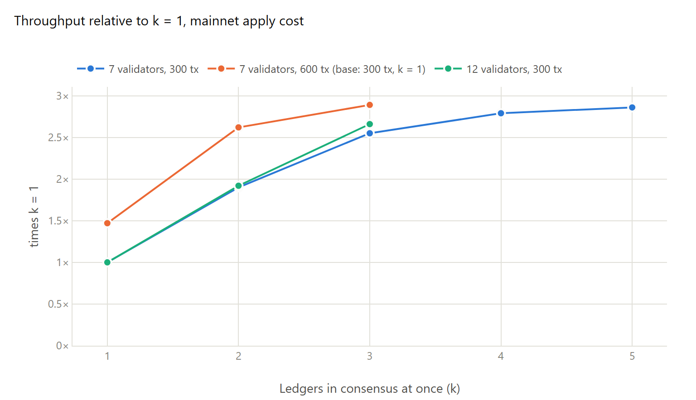
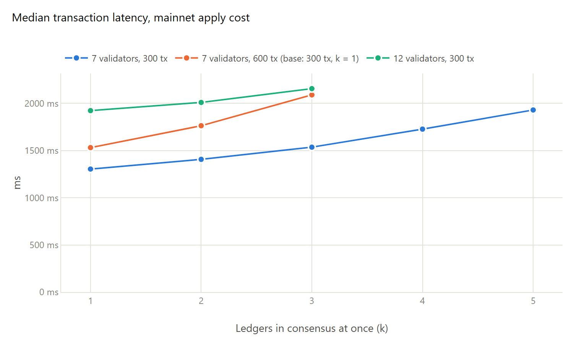
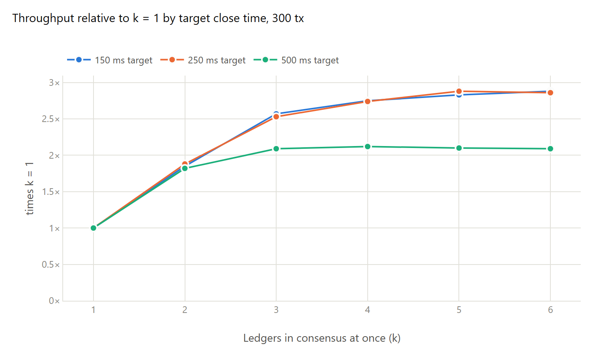

# Testbed results

All the numbers come from the prototype as published (branch `live-pipelining` of
https://github.com/bnogalm/stellar-core) and the scripts in `testbed/`, in one round of runs on
2026-11-09.

## Setup

- **Network.** Every node runs on one machine (Ryzen 7 5800X, 8 cores, 16 threads, data in RAM),
  each in its own network namespace. `netem` adds the delay between each pair of nodes, half the
  round trip each way, from approximate public cloud round trips between seven regions on four
  continents (12–325 ms, `testbed/rtt-7.tsv`), plus 10% jitter, 0.1% loss and 100 Mbit/s per link.
- **Validators.** Seven with a flat quorum (5 of 7), or twelve in four organizations of three, each
  organization on three continents (3 of 4 organizations, 2 of 3 inside each;
  `testbed/rtt-12-orgs.tsv`).
- **Load.** Four non-validating nodes submit one-operation payments at 2,000 tx/s, more than the
  network can take. The numbers are the capacity; latencies are under saturation and count the
  transactions that got in.
- **Apply cost.** stellar-core's testing options `OP_APPLY_SLEEP_TIME_DURATION_FOR_TESTING=[1250]`
  and `OP_APPLY_SLEEP_TIME_WEIGHT_FOR_TESTING=[1]` stretch each ledger's apply to 1.25 ms per
  operation, the mainnet cost per transaction ([mainnet-steps.md](mainnet-steps.md)): about
  375 ms for 300 payments. It is a sleep, so it doesn't use CPU.
- **Rules.** Upgrades run first with 5 s ledgers. Then all nodes are stopped right after a ledger
  closes and started again with the target close time (200 ms unless said) and, for k ≥ 2,
  `EXPERIMENTAL_LIVE_PIPELINE_DEPTH`. `PARALLEL_LEDGER_APPLY` is on (the default); with k = 1 the
  next ledger is triggered after the previous one has been applied, as today.
  `EXPERIMENTAL_TRIGGER_NO_DRIFT_FALLBACK` is on in every run, with and without pipelining (see
  `testbed/README.md`).
- **Measurement.** 180 s of load per point, with the first and last ledgers left out. Seven
  validators with 300 transactions: three runs per point; the rest, one run. Latency is measured on
  validator 1, from when it first receives a transaction (flooded from the nodes that submit it)
  to the externalize of its ledger; "to applied" adds the mean wait
  before apply and the mean apply time to the median.

## k sweep

*Throughput against k = 1. Seven validators with 300 transactions: three runs per point. The 600-transaction line is relative to 300 transactions at k = 1, so its first point is what doubling the ledger gives without pipelining.*

*Median latency, from receipt to externalize.*

| Network | Tx per ledger | k | Interval | Consensus | Apply | Throughput | Gain | Median latency | To applied | p99 |
|---|---|---|---|---|---|---|---|---|---|---|
| 7 validators | 300 | 1 | 1,093 ms | 713 ms | 375 ms | 273 tx/s | 1.00× | 1,304 ms | 1,681 ms | 3,018 ms |
| 7 validators | 300 | 2 | 572 ms | 726 ms | 372 ms | 520 tx/s | 1.90× | 1,407 ms (+8%) | 1,810 ms (+8%) | 3,935 ms |
| 7 validators | 300 | 3 | 427 ms | 768 ms | 373 ms | 697 tx/s | 2.55× | 1,536 ms (+18%) | 2,019 ms (+20%) | 4,684 ms |
| 7 validators | 300 | 4 | 390 ms | 809 ms | 372 ms | 762 tx/s | 2.79× | 1,727 ms (+32%) | 2,438 ms (+45%) | 6,043 ms |
| 7 validators | 300 | 5 | 380 ms | 844 ms | 372 ms | 782 tx/s | 2.86× | 1,930 ms (+48%) | 2,933 ms (+74%) | 7,045 ms |
| 7 validators | 600 | 1 | 1,486 ms | 728 ms | 749 ms | 402 tx/s | 1.47× | 1,531 ms (+17%) | 2,286 ms (+36%) | 3,465 ms |
| 7 validators | 600 | 2 | 831 ms | 791 ms | 743 ms | 716 tx/s | 2.62× | 1,763 ms (+35%) | 2,601 ms (+55%) | 5,339 ms |
| 7 validators | 600 | 3 | 746 ms | 851 ms | 736 ms | 790 tx/s | 2.89× | 2,090 ms (+60%) | 3,419 ms (+103%) | 6,658 ms |
| 12 validators | 300 | 1 | 1,449 ms | 1,068 ms | 375 ms | 206 tx/s | 1.00× | 1,923 ms | 2,302 ms | 3,990 ms |
| 12 validators | 300 | 2 | 751 ms | 1,073 ms | 371 ms | 396 tx/s | 1.92× | 2,010 ms (+5%) | 2,419 ms (+5%) | 5,182 ms |
| 12 validators | 300 | 3 | 542 ms | 1,145 ms | 372 ms | 547 tx/s | 2.66× | 2,156 ms (+12%) | 2,594 ms (+13%) | 6,108 ms |

The gain and latency change of the 600-transaction rows are against 300 transactions at k = 1. The
three runs of each 300-transaction point agree within 4% in throughput and in median latency. No run had a crash, a node out of
sync or a tx set with a transaction of the wrong class.

## What the numbers say

Without pipelining the interval is consensus plus apply plus completion: 713 + 375 + 5 ≈ 1,093 ms.
With k ledgers in flight it follows

    interval ≈ max(target, (C + E + S) / k, E)

k = 2 gives 572 ms (the formula says 547), k = 3 427 ms (formula 364, but consensus gets slower
with more ledgers in flight: 768 ms instead of 713), and from k = 4 the interval stays near the
apply time, about 375–390 ms. Apply is sequential, each ledger needs the state of the one before,
so it is the ceiling: 1.25 ms per transaction means at most 800 tx/s, whatever k or ledger size.
The largest configurations end close to it (782 and 790 tx/s).

Latency goes up because a transaction waits for a ledger of its class whose consensus hasn't
started yet, and from k = 4 also because ledgers wait to be applied (queue: 31 ms at k = 2,
110 ms at k = 3, 339 ms at k = 4, 630 ms at k = 5).

For the same throughput, smaller ledgers with a larger k had lower latency than bigger ledgers
with a smaller k:

| Throughput | 600 transactions | 300 transactions |
|---|---|---|
| about 700 tx/s | k = 2: 716 tx/s, p50 1,763 ms, to applied 2,601 ms | k = 3: 697 tx/s, p50 1,536 ms, to applied 2,019 ms |
| about 785 tx/s | k = 3: 790 tx/s, p50 2,090 ms, to applied 3,419 ms | k = 5: 782 tx/s, p50 1,930 ms, to applied 2,933 ms |

Not measured: SDF's planned overlap of consensus with apply, where the interval would be about
max(C, E) at best. As an estimate, ignoring completion and the cost of the handoff: for 300
transactions max(713, 375) ≈ 715 ms, about 420 tx/s against 520 with k = 2; for 600
transactions max(728, 749) ≈ 750 ms, about 800 tx/s, the ceiling. With apply overlapped, a bigger
ledger gets close to the same ceiling, so these data can't say which has less latency. Pipelining
adds more the longer consensus is compared with apply: on this testbed C/E is about 1.9 at 300
transactions and about 1.0 at 600.

## Target close time

*Gain against k = 1 at the same target, 300 transactions, seven validators, one run per point. At 500 ms the target becomes the limit from k = 3.*

| Target | k = 1 | k = 2 | k = 3 | k = 4 | k = 5 | k = 6 |
|---|---|---|---|---|---|---|
| 150 ms | 275 tx/s, 1,286 ms | 508, 1,459 ms | 707, 1,512 ms | 756, 1,725 ms | 779, 1,943 ms | 793, 2,127 ms |
| 250 ms | 274 tx/s, 1,309 ms | 516, 1,427 ms | 692, 1,523 ms | 751, 1,743 ms | 788, 1,907 ms | 785, 2,145 ms |
| 500 ms | 277 tx/s, 1,318 ms | 504, 1,436 ms | 580, 1,625 ms | 586, 2,003 ms | 582, 2,256 ms | 578, 2,547 ms |

(Throughput and median latency.) At 150 and 250 ms the target hardly matters: the interval is set
by consensus and apply. At 500 ms the interval can't go below the target, so from k = 3 the gain
stays at about 2.1× and only latency grows (+23% at k = 3, +93% at k = 6, against k = 1 at the
same target). The target should be about consensus / k: with consensus at about 725 ms, below
360 ms for k = 2 and 240 ms for k = 3.

## Predictable leaders

With k ≥ 2 the nomination leaders of N are known about one consensus round before nomination of N
starts, which gives an attacker time to aim at them. The testbed can't measure how much easier
that makes the attack; it measures what the attack costs when it works, the same way with and
without pipelining. With `EXPERIMENTAL_TEST_DOS_TOP_LEADER`, each validator stays silent in the
first nomination round of every ledger where it has the top priority, and sends its nomination in
the next round, as if a DoS had taken it down for one round. Same setup as the k sweep (seven
validators, 300 transactions, 200 ms target), one run per point.

| | k = 1 | k = 2 |
|---|---|---|
| No attack (k sweep, three runs) | 273 tx/s, interval 1,093 ms, p50 1,304 ms | 520 tx/s, 572 ms, p50 1,407 ms |
| Attack, one leader per round | 143 tx/s (−48%), 2,096 ms, p50 2,874 ms | 282 tx/s (−46%), 1,061 ms, p50 2,907 ms |
| Attack, two leaders per round and a 300 ms nomination timeout | 263 tx/s (−4%), 1,138 ms, p50 1,354 ms | 474 tx/s (−9%), 630 ms, p50 1,569 ms |
| Two leaders and 300 ms, no attack | 275 tx/s (+1%), 1,091 ms, p50 1,221 ms | 503 tx/s (−3%), 596 ms, p50 1,400 ms |

The attack costs every ledger a nomination timeout (1 s here), so it roughly halves throughput
with and without pipelining. `EXPERIMENTAL_NOMINATION_LEADERS=2` takes the two nodes with the
highest priority as leaders of each round, so the attacker has to take down both;
`EXPERIMENTAL_NOMINATION_TIMEOUT_MS=300` sets the nomination timeout close to the measured round
time, so a lost round costs less. Together they bring the loss under 10%, and cost 0–3% without
an attack. A secret leader priority (a VRF) would remove the predictability itself
([live-pipelining-threats.md](../design/live-pipelining-threats.md), L2).

## Limits

- One machine runs all the nodes (host CPU stayed under 55%, and reached 71% with twelve
  validators at k = 3); apply is a sleep calibrated on a
  mainnet replay, an average over mainnet's mix rather than real Soroban or DEX work, and the disk
  is in RAM.
- The network delays are approximations I chose; real validators also differ in hardware.
- p99 latency grows faster than the median: at k = 3, 4.7 s against 3.0 s at k = 1.

## Data

- Run summaries: [data/testbed](data/testbed) (`core-summaries.txt`, `grid-summaries.txt`,
  `attack-summaries.txt`); node 1 logs for the Gantt charts in [data/testbed/gantt](data/testbed/gantt).
- Chart data: [testbed-results.json](testbed-results.json), generated by
  `tools/charts.py cl results/testbed-results.json results/data/testbed/*-summaries.txt`.
- The runs: `testbed/runs/core.sh`, `attack.sh`, `grid.sh`.
