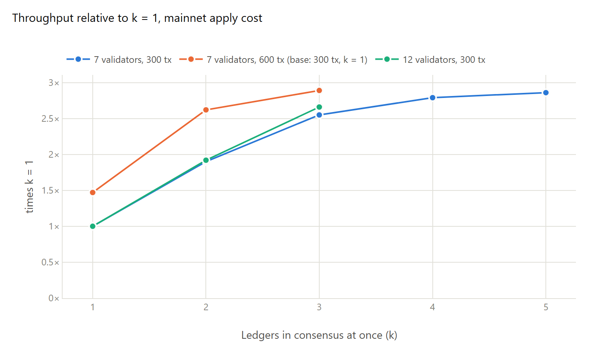
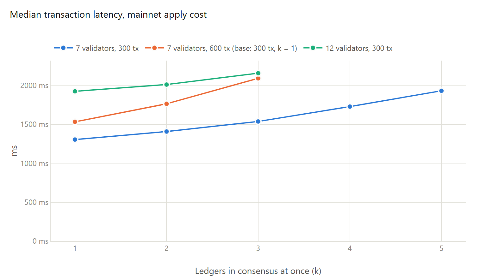
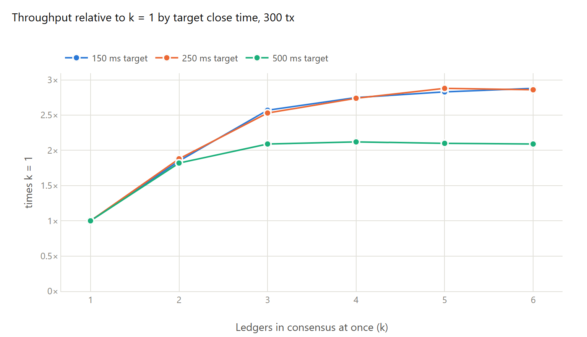

# Testbed results: pipelining against today's protocol

Today consensus on a ledger starts once the previous one has been applied. This report measures
what k ledgers in consensus at once give against that, on a WAN testbed. The numbers come from
one round of runs on 2026-11-09, with commit `b7d9533cb` of the branch `live-pipelining` of
https://github.com/bnogalm/stellar-core and the scripts in `testbed/`. The k sweep was run again
with the current code: the same throughput within about 1 %.

## Short answer

- **k = 2 gives 1.9× the throughput and k = 4 gives 2.8×,** for 8% and 32% more median latency:
  seven validators on four continents, 300 transactions per ledger, apply at mainnet's cost.
- **The interval between ledgers follows max(L, (C + E + S) / k, E):** consensus and apply shared
  among k ledgers, down to one apply.
- **Apply is the ceiling,** since it is sequential: 800 tx/s at 1.25 ms per transaction, whatever
  k or the ledger size. The largest configurations end at 782 and 790 tx/s.
- **Latency hardly grows while k only shares consensus:** 8% at k = 2. A payer enters one ledger
  in k, and ledgers come k times as often. It grows more when k is deeper than apply allows.
  A client with a payer account in every class waits k times less.

Two later reports complete it:

- [throughput-current.md](throughput-current.md): the sweep with the current code, up to
  k = 8. The gain stops at k = 4 to 5.
- [when-pipelining-pays.md](when-pipelining-pays.md): the comparison with the overlap of
  consensus and apply that SDF plans, which this round did not measure.

## The model

    interval ≈ max(L, (C + E + S) / k, E)        throughput = n / interval

| Constant | On this testbed |
|---|---|
| C, consensus of a ledger | 713 ms with seven validators, 1,068 ms with twelve |
| E, apply | 375 ms: 300 payments at 1.25 ms each, mainnet's cost per transaction ([mainnet-steps.md](mainnet-steps.md)) |
| S, completion on the main thread | about 5 ms |
| L, target close time | 200 ms |
| n, transactions per ledger | 300 or 600 |

## What it gives

*Throughput against k. Seven validators with 300 transactions: three runs per point. The dashed line is the ceiling set by sequential apply at 1.25 ms per transaction: every line approaches it as k grows.*

*Median latency, from receipt to externalize.*

Seven validators, 300 transactions per ledger (all the runs are in the appendix):

| k | Interval | Consensus | Throughput | Gain | Median latency | p99 |
|---|---|---|---|---|---|---|
| 1 | 1,093 ms | 713 ms | 273 tx/s | 1.00× | 1,304 ms | 3,018 ms |
| 2 | 572 ms | 726 ms | 520 tx/s | 1.90× | 1,407 ms (+8%) | 3,935 ms |
| 3 | 427 ms | 768 ms | 697 tx/s | 2.55× | 1,536 ms (+18%) | 4,684 ms |
| 4 | 390 ms | 809 ms | 762 tx/s | 2.79× | 1,727 ms (+32%) | 6,043 ms |
| 5 | 380 ms | 844 ms | 782 tx/s | 2.86× | 1,930 ms (+48%) | 7,045 ms |

- **k = 1:** the interval is consensus plus apply plus completion, 713 + 375 + 5 ≈ 1,093 ms.
- **k = 2 and 3:** 572 ms (the formula says 547) and 427 ms (formula 364). Consensus gets slower
  with more ledgers in flight: 768 ms at k = 3 instead of 713.
- **From k = 4** the interval stays near the apply time, about 375–390 ms. Apply is sequential,
  each ledger needs the state of the one before, so it is the ceiling: 1.25 ms per transaction
  means at most 800 tx/s.
- **Larger ledgers:** with 600 transactions apply takes 749 ms, as long as consensus, and k = 3
  is already at the ceiling: 790 tx/s.
- **More validators:** twelve, in four organizations, take 1,068 ms per consensus and gain the
  same: 1.92× at k = 2 and 2.66× at k = 3.
- **Latency:** a payer enters one ledger in k, so its next ledger comes every k intervals. At
  k = 2 that is 1,144 ms, against 1,093 ms without pipelining, and latency is 8% higher. From
  k = 4 ledgers cannot come faster than one apply and wait to be applied (queue: 31 ms at k = 2,
  110 ms at k = 3, 339 ms at k = 4, 630 ms at k = 5): a payer's next ledger comes every 1,560 ms
  at k = 4, and latency is 32% higher. Consensus is also slower with more ledgers in flight.
- **For the same throughput,** smaller ledgers with a larger k had lower latency than bigger
  ledgers with a smaller k: at about 700 tx/s, a median of 1,536 ms with 300 transactions and
  k = 3, against 1,763 ms with 600 and k = 2.
- **Against the planned overlap** of consensus and apply this round has no measurement. On this
  testbed consensus takes about 1.9 times apply at 300 transactions and 1.0 at 600, and
  pipelining adds more the longer consensus is compared with apply.
  [when-pipelining-pays.md](when-pipelining-pays.md) measures and simulates it.

The three runs of each 300-transaction point agree within 4% in throughput and in median
latency. No run had a crash, a node out of sync or a tx set with a transaction of the wrong
class.

## Target close time

*Gain against k = 1 at the same target, 300 transactions, seven validators, one run per point. At 500 ms the target becomes the limit from k = 3.*

At 150 and 250 ms the target hardly matters: the interval is set by consensus and apply. At
500 ms the interval can't go below the target, so from k = 3 the gain stays at about 2.1× and
only latency grows (+23% at k = 3, +93% at k = 6, against k = 1 at the same target). The target
should be about consensus / k: with consensus at about 725 ms, below 360 ms for k = 2 and 240 ms
for k = 3.

## Predictable leaders

The nomination leaders of a ledger are known before its nomination starts, which gives an
attacker time to aim at them. Pipelining does not add to that time. Here it is the queue plus
the apply of N−k, about 0.4 s at k = 2, against one apply, also about 0.4 s, at k = 1; on
mainnet today it is the 4.4 s that nomination waits for the timer
([mainnet-steps.md](mainnet-steps.md)). What short ledgers change is the cost of each hit. The
testbed can't measure how hard the attack is; it measures what the attack costs when it works,
the same way with and without pipelining.

With `EXPERIMENTAL_TEST_DOS_TOP_LEADER`, each validator stays silent in the first nomination
round of every ledger where it has the top priority, and sends its nomination in the next round,
as if a DoS had taken it down for one round. Same setup as the runs above (seven validators, 300
transactions, 200 ms target), one run per point.

| | k = 1 | k = 2 |
|---|---|---|
| No attack (the runs above, three per point) | 273 tx/s, interval 1,093 ms, p50 1,304 ms | 520 tx/s, 572 ms, p50 1,407 ms |
| Attack, one leader per round | 143 tx/s (−48%), 2,096 ms, p50 2,874 ms | 282 tx/s (−46%), 1,061 ms, p50 2,907 ms |
| Attack, two leaders per round and a 300 ms nomination timeout | 263 tx/s (−4%), 1,138 ms, p50 1,354 ms | 474 tx/s (−9%), 630 ms, p50 1,569 ms |
| Two leaders and 300 ms, no attack | 275 tx/s (+1%), 1,091 ms, p50 1,221 ms | 503 tx/s (−3%), 596 ms, p50 1,400 ms |

The attack costs every ledger a nomination timeout (1 s here), so it roughly halves throughput
with and without pipelining. `EXPERIMENTAL_NOMINATION_LEADERS=2` takes the two nodes with the
highest priority as leaders of each round, so the attacker has to take down both;
`EXPERIMENTAL_NOMINATION_TIMEOUT_MS=300` sets the nomination timeout close to the measured round
time, so a lost round costs less. Together they bring the loss under 10%, and cost 0–3% without
an attack. A secret leader priority (a VRF) would remove the predictability itself
([live-pipelining-threats.md](../design/live-pipelining-threats.md), L2).

## Setup

- **Network.** Every node runs on one machine (Ryzen 7 5800X, 8 cores, 16 threads, data in RAM),
  each in its own network namespace. `netem` delays each pair of nodes by the round trip between
  seven cloud regions on four continents (12–325 ms, `testbed/rtt-7.tsv`), with 10% jitter, 0.1%
  loss and 100 Mbit/s per link.
- **Validators.** Seven with a flat quorum (5 of 7), or twelve in four organizations of three,
  each on three continents (3 of 4 organizations, 2 of 3 inside each; `testbed/rtt-12-orgs.tsv`).
- **Load.** Four non-validating nodes submit one-operation payments at 2,000 tx/s, more than the
  network can take: the numbers are the capacity, and latencies are under saturation and count
  the transactions that got in.
- **Apply.** A sleep of 1.25 ms per operation (stellar-core's
  `OP_APPLY_SLEEP_TIME_DURATION_FOR_TESTING=[1250]` and `OP_APPLY_SLEEP_TIME_WEIGHT_FOR_TESTING=[1]`),
  so it doesn't use CPU.
- **Rules.** Upgrades run first with 5 s ledgers. Then every node restarts with the target close
  time (200 ms unless said) and, for k ≥ 2, `EXPERIMENTAL_LIVE_PIPELINE_DEPTH`.
  `PARALLEL_LEDGER_APPLY` is on (the default); with k = 1 the next ledger is triggered after the
  previous one has been applied, as today. `EXPERIMENTAL_TRIGGER_NO_DRIFT_FALLBACK` is on in every
  run (`testbed/README.md`).
- **Measurement.** 180 s of load per point, with the first and last ledgers left out; three runs
  per point for seven validators with 300 transactions, one for the rest. Latency is from when
  validator 1 first receives a transaction to the externalize of its ledger; "to applied" adds
  the mean wait before apply and the mean apply time to the median. Each transaction pays from
  one account, so it is the latency of a client with one payer account.

## Limits

- One machine runs all the nodes (host CPU stayed under 55%, and reached 71% with twelve
  validators at k = 3); apply is a sleep calibrated on a
  mainnet replay, an average over mainnet's mix rather than real Soroban or DEX work, and the disk
  is in RAM.
- The network delays are approximations I chose; real validators also differ in hardware.
- p99 latency grows faster than the median: at k = 3, 4.7 s against 3.0 s at k = 1.

## Data

- Run summaries: [data/testbed](data/testbed) (`core-summaries.txt`, `grid-summaries.txt`,
  `attack-summaries.txt`); node 1 logs for the Gantt charts in [data/testbed/gantt](data/testbed/gantt).
- Chart data: [testbed-results.json](testbed-results.json), generated by
  `tools/charts.py cl results/testbed-results.json results/data/testbed/*-summaries.txt`.
- The runs: `testbed/runs/core.sh`, `attack.sh`, `grid.sh`.

## Appendix: all the runs

The gain and latency change of the 600-transaction rows are against 300 transactions at k = 1.

| Network | Tx per ledger | k | Interval | Consensus | Apply | Throughput | Gain | Median latency | To applied | p99 |
|---|---|---|---|---|---|---|---|---|---|---|
| 7 validators | 300 | 1 | 1,093 ms | 713 ms | 375 ms | 273 tx/s | 1.00× | 1,304 ms | 1,681 ms | 3,018 ms |
| 7 validators | 300 | 2 | 572 ms | 726 ms | 372 ms | 520 tx/s | 1.90× | 1,407 ms (+8%) | 1,810 ms (+8%) | 3,935 ms |
| 7 validators | 300 | 3 | 427 ms | 768 ms | 373 ms | 697 tx/s | 2.55× | 1,536 ms (+18%) | 2,019 ms (+20%) | 4,684 ms |
| 7 validators | 300 | 4 | 390 ms | 809 ms | 372 ms | 762 tx/s | 2.79× | 1,727 ms (+32%) | 2,438 ms (+45%) | 6,043 ms |
| 7 validators | 300 | 5 | 380 ms | 844 ms | 372 ms | 782 tx/s | 2.86× | 1,930 ms (+48%) | 2,933 ms (+74%) | 7,045 ms |
| 7 validators | 600 | 1 | 1,486 ms | 728 ms | 749 ms | 402 tx/s | 1.47× | 1,531 ms (+17%) | 2,286 ms (+36%) | 3,465 ms |
| 7 validators | 600 | 2 | 831 ms | 791 ms | 743 ms | 716 tx/s | 2.62× | 1,763 ms (+35%) | 2,601 ms (+55%) | 5,339 ms |
| 7 validators | 600 | 3 | 746 ms | 851 ms | 736 ms | 790 tx/s | 2.89× | 2,090 ms (+60%) | 3,419 ms (+103%) | 6,658 ms |
| 12 validators | 300 | 1 | 1,449 ms | 1,068 ms | 375 ms | 206 tx/s | 1.00× | 1,923 ms | 2,302 ms | 3,990 ms |
| 12 validators | 300 | 2 | 751 ms | 1,073 ms | 371 ms | 396 tx/s | 1.92× | 2,010 ms (+5%) | 2,419 ms (+5%) | 5,182 ms |
| 12 validators | 300 | 3 | 542 ms | 1,145 ms | 372 ms | 547 tx/s | 2.66× | 2,156 ms (+12%) | 2,594 ms (+13%) | 6,108 ms |

For the same throughput, 600 transactions per ledger against 300:

| Throughput | 600 transactions | 300 transactions |
|---|---|---|
| about 700 tx/s | k = 2: 716 tx/s, p50 1,763 ms, to applied 2,601 ms | k = 3: 697 tx/s, p50 1,536 ms, to applied 2,019 ms |
| about 785 tx/s | k = 3: 790 tx/s, p50 2,090 ms, to applied 3,419 ms | k = 5: 782 tx/s, p50 1,930 ms, to applied 2,933 ms |

Throughput and median latency against the target close time (300 transactions, seven
validators, one run per point):

| Target | k = 1 | k = 2 | k = 3 | k = 4 | k = 5 | k = 6 |
|---|---|---|---|---|---|---|
| 150 ms | 275 tx/s, 1,286 ms | 508, 1,459 ms | 707, 1,512 ms | 756, 1,725 ms | 779, 1,943 ms | 793, 2,127 ms |
| 250 ms | 274 tx/s, 1,309 ms | 516, 1,427 ms | 692, 1,523 ms | 751, 1,743 ms | 788, 1,907 ms | 785, 2,145 ms |
| 500 ms | 277 tx/s, 1,318 ms | 504, 1,436 ms | 580, 1,625 ms | 586, 2,003 ms | 582, 2,256 ms | 578, 2,547 ms |
