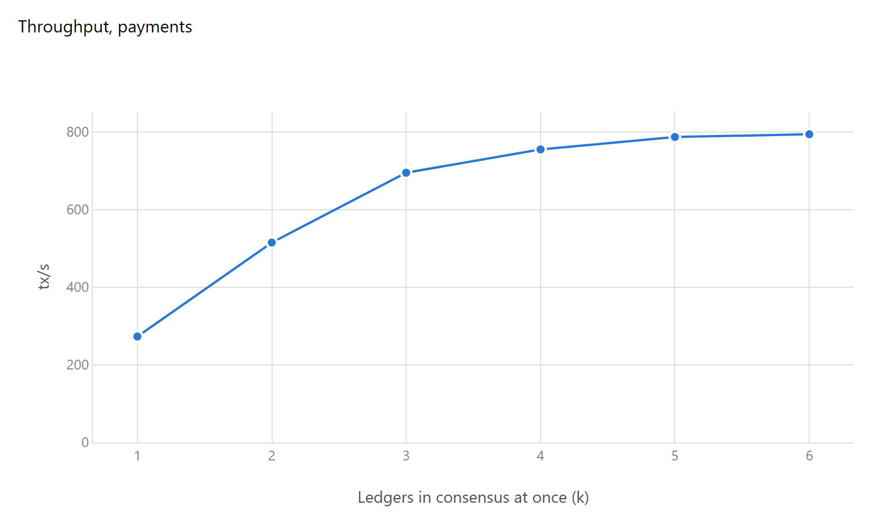
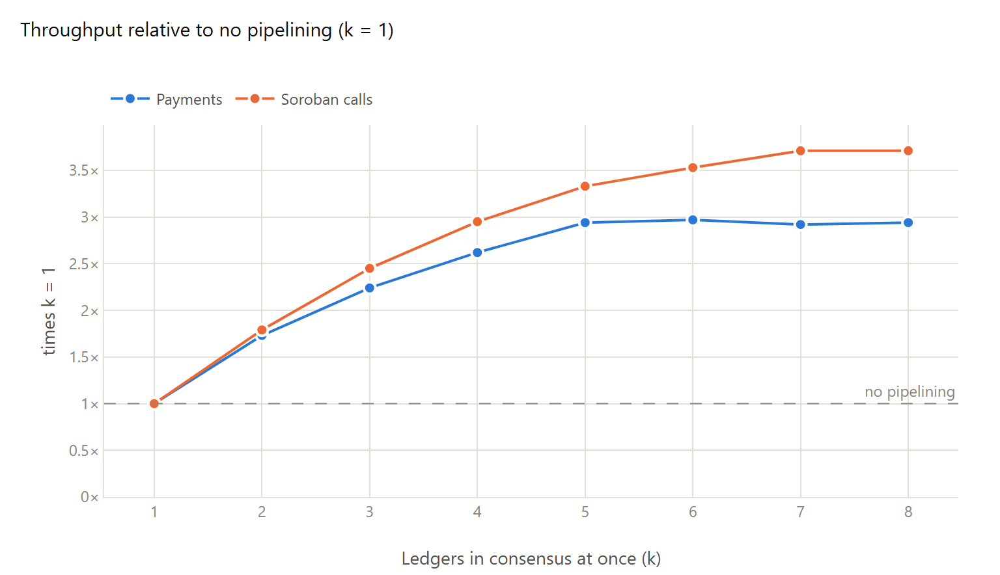
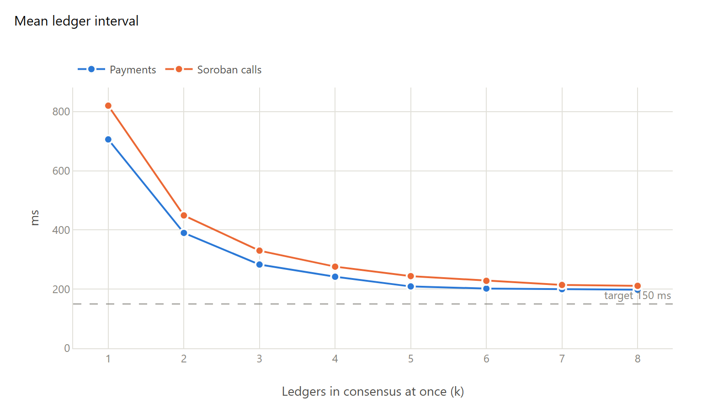

# Throughput against k

Date: 2026-11-15 and 16. Where does k stop paying off? The gains are against today's protocol with ledgers back to back, where consensus and apply run one after the other. Against the planned overlap of the two, see [when-pipelining-pays.md](when-pipelining-pays.md).

## Short answer

- **The gain stops where the interval reaches its floor.** The interval follows max(L, (C + E + S) / k, E): the target, consensus and apply shared among k ledgers, or one apply.
  - With the apply cost of mainnet it stops at k = 4 to 5, at about 790 tx/s, 2.9× the network without pipelining: the interval reaches the apply time.
  - With lighter ledgers it goes on further: 2.9× at k = 5 with light payments, and 3.7× at k = 7 with Soroban calls.
- **The best k is the smallest that reaches the floor:** k = ⌈(C + E + S) / L⌉, the rule of the draft CAP, with apply as the second bound. Each k beyond it adds latency and no throughput.

## Method

- **Code:** the branch `live-pipelining`: k in the ledger, a fee reserve, restarts and catchup, and every rule checked against N−k.
- **Network:** the WAN testbed of [testbed-results.md](testbed-results.md): seven validators with inter-region delays, 10 % jitter and 0.1 % loss on the links, protocol 30, and four watchers.
- **Runs:** `testbed/ksweep.sh`, one fresh network per point, about 180 s of load each. The values are the means over the seven validators.
- **k:** set by a flags upgrade during the genesis phase (`KSWEEP_K_UPGRADE=1`), as a network would.
- **Latency:** from submission to externalize. Each transaction pays from one account, so it is the latency of a client with one payer account.

Two sweeps:

- **A: light transactions.** 150 ms target close time:
  - payments: 2,000 tx/s offered, 200-operation tx set limit;
  - Soroban calls: 4M instructions, 2 entries and 2 kB of IO each, 700 tx/s offered.
- **B: the apply cost of mainnet,** the setup of [testbed-results.md](testbed-results.md). Payments with 1.25 ms of apply per operation and a 300-operation tx set limit, at a 200 ms target, with 2,000 tx/s offered from four load nodes. Two runs.

In every point there was no crash and no transaction in a ledger of the wrong class.

## B: the apply cost of mainnet

Where does throughput flatten when apply costs what it does on mainnet?

*B, run 1: payments with the apply cost of mainnet, transactions per second against k.*

The ceiling is applying the ledgers one after the other. 300 operations at 1.25 ms are 375 ms of apply per ledger, and the interval converges to it: 378 ms at k = 5, 374 ms at k = 6. Throughput flattens at about 790–800 tx/s, 2.9× the network without pipelining. Past k = 4 to 5 the gain is under 5 %. Going further needs a parallel apply, not a deeper pipeline.

| k | Throughput, run 1 / 2 | Interval | Against k = 1 |
|---|---|---|---|
| 1 | 273 / 269 tx/s | 1,093 / 1,110 ms | 1.00× |
| 2 | 515 / 518 | 582 / 574 ms | 1.89× / 1.93× |
| 3 | 695 / 688 | 428 / 433 ms | 2.55× / 2.56× |
| 4 | 755 / 754 | 396 / 394 ms | 2.77× / 2.80× |
| 5 | 787 / 786 | 378 / 379 ms | 2.88× / 2.92× |
| 6 | 794 / 797 | 374 / 373 ms | 2.91× / 2.96× |

This repeats the k sweep of [testbed-results.md](testbed-results.md), which ran on an earlier commit of the branch: the throughput is the same within about 1 %.

## A: light transactions

How much does each k add when apply is cheap, and what stops the gain?

*A: throughput relative to k = 1.*

*A: mean time between ledgers against k.*

- **Payments:** throughput is flat from k = 5 at about 770–780 tx/s. The mean interval stays near 200 ms at a 150 ms target: the tail of slow rounds keeps it there while the median keeps falling. Each k above 5 adds about 0.4 s of latency (p50 2.1 s at k = 5, 3.2 s at k = 8) and nothing in throughput.
- **Soroban calls:** each ledger has about 100 calls and 80 to 120 ms of apply, so the interval keeps falling past k = 5, down to about 210 ms at k = 7. Throughput grows to 445 tx/s (3.7×) at k = 7, flat at k = 8, with p50 latency from 1.4 s to 2.8 s.
- **Close times that apply had to raise** grow with k: 0, 0, 1, 8, 77 and 178 on validator 1 for k = 1 to 6, with payments.

The figures by k are in the appendix.

## Appendix: sweep A by k

Payments:

| k | Throughput | Interval (p50 / p99) | Latency, submit to externalize (p50) |
|---|---|---|---|
| 1 | 263 tx/s | 706 ms (669 / 1,421) | 1,382 ms |
| 2 | 454 (1.73×) | 390 ms (361 / 1,280) | 1,529 ms |
| 3 | 590 (2.24×) | 283 ms (246 / 1,073) | 1,655 ms |
| 4 | 688 (2.62×) | 242 ms (188 / 1,093) | 1,972 ms |
| 5 | 772 (2.94×) | 209 ms (168 / 912) | 2,112 ms |
| 6 | 780 (2.97×) | 202 ms (149 / 929) | 2,357 ms |
| 7 | 768 (2.92×) | 200 ms (113 / 992) | 2,801 ms |
| 8 | 773 (2.94×) | 198 ms (48 / 1,069) | 3,203 ms |

Soroban calls:

| k | Throughput | Interval (p50 / p99) | Latency (p50) |
|---|---|---|---|
| 1 | 120 tx/s | 820 ms (781 / 1,524) | 1,449 ms |
| 2 | 215 (1.79×) | 449 ms (439 / 1,431) | 1,588 ms |
| 3 | 294 (2.45×) | 330 ms (290 / 1,093) | 1,778 ms |
| 4 | 354 (2.95×) | 276 ms (243 / 994) | 1,946 ms |
| 5 | 399 (3.33×) | 244 ms (207 / 1,007) | 2,163 ms |
| 6 | 424 (3.53×) | 228 ms (182 / 908) | 2,440 ms |
| 7 | 445 (3.71×) | 214 ms (180 / 834) | 2,751 ms |
| 8 | 445 (3.71×) | 211 ms (123 / 1,001) | 3,105 ms |

The Soroban points ran with a fee reserve of 1,000 XLM instead of the default 1 XLM. The setup's wasm upload costs more than 1 XLM in fees, and in a ledger of its class an account pays at most its reserve in fees ([decisions.md](../design/decisions.md), decision 4). The invoke load spends nothing in ledgers of other classes, so the reserve does not bind otherwise.
