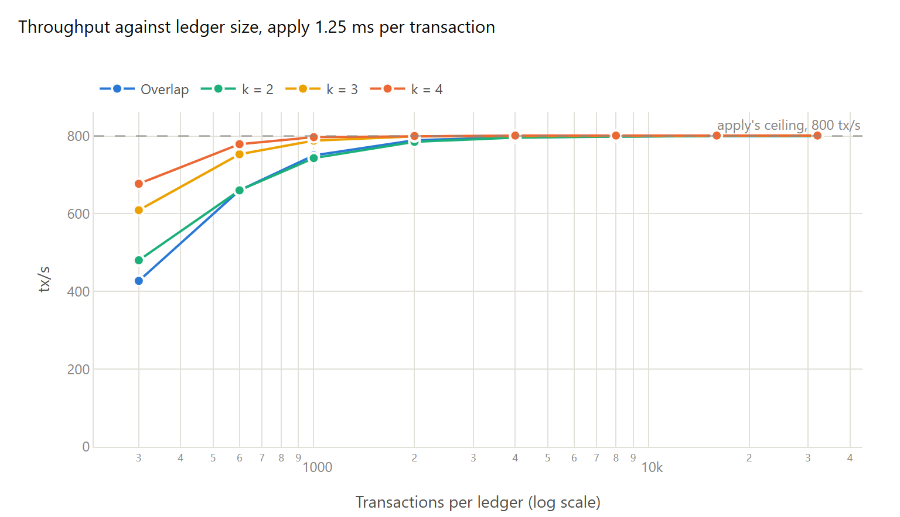
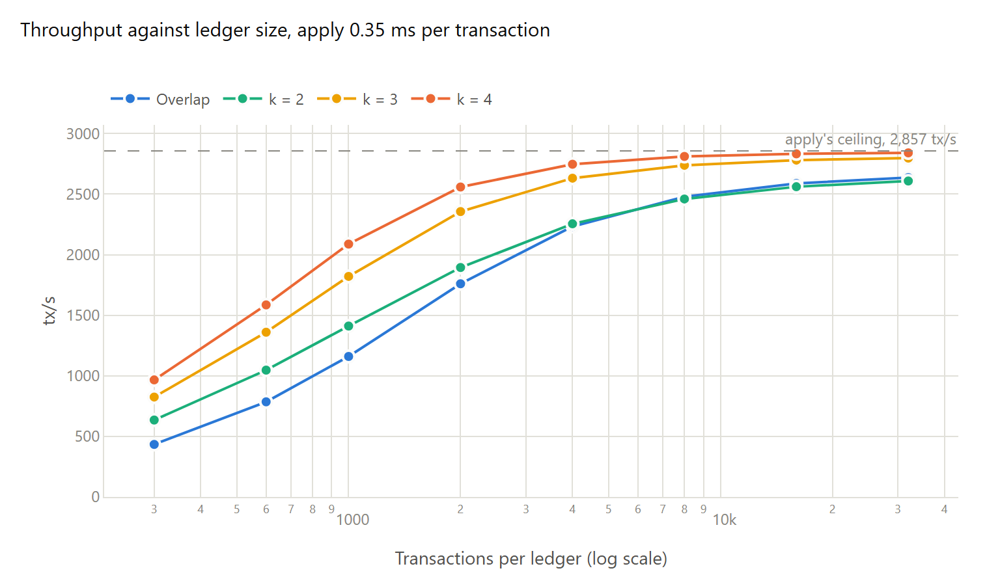
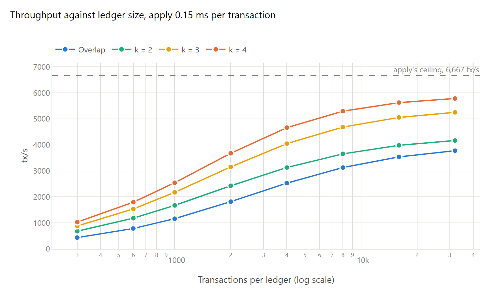
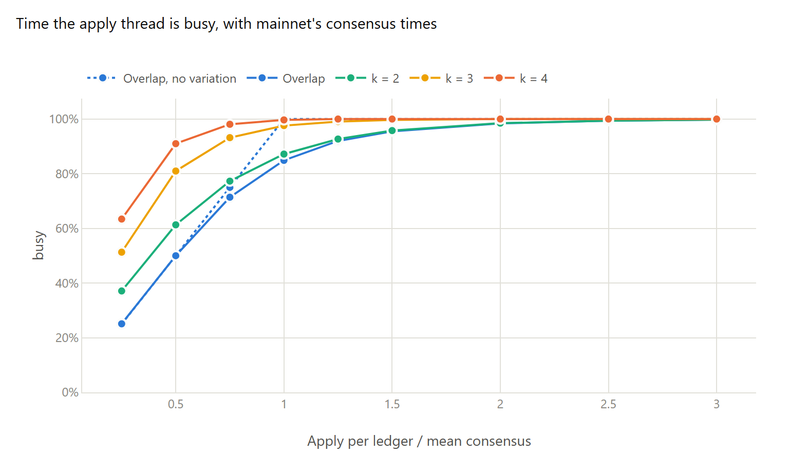
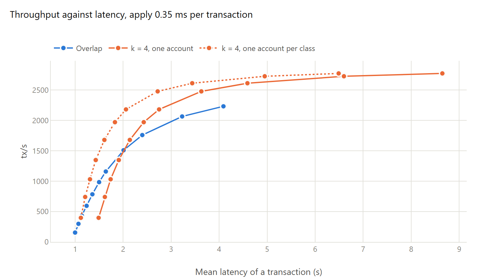

# When pipelining pays: against the overlap of consensus and apply

Date: 2026-11-16, updated 2026-11-17. SDF is working on overlapping the consensus of ledger N+1
with the apply of N
([The road to 5000 TPS](https://stellar.org/blog/developers/the-road-to-5000-tps-scaling-stellar-in-2025)).
Its [roadmap](https://stellar.org/foundation/roadmap) calls that step pipelining consensus and
execution, and aims at ledgers every 2.5 s. This report calls it the overlap, and keeps
"pipelining" for what goes further: k ledgers in consensus at once. It asks when that extra
complexity buys something the overlap cannot, with a model of both whose constants are measured
on the testbed and on mainnet. The overlap is not implemented anywhere: it is taken at its best
case.

## Short answer

**Pipelining only pays when applying a ledger takes clearly less time than its consensus.** When
apply takes as long as consensus or longer, the overlap already keeps apply busy, and pipelining
adds latency and complexity for nothing.

Both have the same ceiling. Apply is sequential, so neither can process more than one transaction
per apply time: 800 tx/s at 1.25 ms per transaction. They differ in the ledger size at which they
get there.

Pipelining is worth its complexity when all three of these hold:

1. **Validators apply fast:** a ledger's apply well under its consensus (about 0.6 s on mainnet).
   A fast node with its state in RAM already does: 150 to 200 ms for about 420 transactions. A
   desktop replaying mainnet took 1.25 ms per transaction. Validators are somewhere in between,
   and parallel apply would make them faster.
2. **Ledger size is bounded,** by the network cap (1,000 classic operations today), by latency, or
   by what big tx sets cost in consensus: on the testbed it took 0.8 s with 1,000 payments per
   ledger and 2.65 s with 10,000.
3. **The network needs more than the overlap gives:** ledgers closer than about 0.65 s apart, or,
   with today's cap, more than about 1,500 operations per second.

When they hold, pipelining at k = 3–4 gives 1.5 to 2× the throughput of the overlap at the same
ledger size (2.5× on the testbed at 300 transactions per ledger, against the overlap's best
case). The overlap matches it only with
ledgers 3 to 4 times larger. Latency depends on the client. With one payer account it is higher
than with the overlap, which shortens the wait for the next ledger for every account. With a
payer account in every class it is lower than with the overlap, at the same throughput. If any
of the three fails, the overlap is the better choice.

**For mainnet in the medium term they do not hold.** Ledgers close every 5 s (SDF's target is
2.5 s), consensus and apply together take about 1 s of that or less, and demand is about 145
operations per second. The timer bounds throughput, not consensus or apply. Pipelining could be
a step after the overlap, if the network ever wants sub-second ledgers or a few thousand
operations per second.

**With ledgers several times larger the choice is open.** The overlap catches up by growing
ledgers only while a transaction adds more to apply than to consensus, and the measured cases
fall on both sides ("e against B" below).

The same, by situation:

| Situation | Better choice |
|---|---|
| Apply as long as consensus or longer | Overlap: the same throughput, simpler |
| A ledger every 2.5 s or more (mainnet now and SDF's target) | Overlap, or neither: the timer bounds |
| Ledger size free, a few seconds of latency acceptable, and a transaction adds more to apply than to consensus | Overlap with bigger ledgers |
| Apply clearly shorter than consensus, ledger size bounded, more than the overlap's 0.65 s / 1,500 ops/s needed | Pipelining, k = 3–4: 1.5–2× |
| A transaction adds less to apply than to consensus | Pipelining: the overlap cannot reach apply's ceiling at any size |

## The model

For a ledger of n transactions:

- **Consensus** takes C = (A + B · n) · r. r is the variation from ledger to ledger, 1 on
  average. With k ledgers in consensus at once it takes C · (1 + G · (k − 1)).
- **Apply** takes E = F + e · n.
- **The overlap** closes a ledger every max(C, E).
- **Pipelining** closes one every max(E, (C + E) / k): slot N opens when N−k is applied.
- **Throughput** is n over that interval. The ceiling of both is n / E, about 1 / e.

What follows:

- **At the same ledger size** pipelining gains nothing once E ≥ C. With E < C it gains up to
  C / E, with k about 1 + C / E.
- **By growing ledgers** the overlap gets to the ceiling at the size where apply takes as long as
  consensus, n* = (A − F) / (e − B). That size exists only if e > B. With e below B the overlap
  tends to 1 / B transactions per second, below the ceiling.
- **Variation:** the overlap's interval is the mean of max(C, E), which is above
  max(mean C, E). Apply waits whenever a consensus takes longer than the apply before it. With
  pipelining, other agreed ledgers wait ahead.
- **Latency** of a transaction is the wait for the next ledger it can enter, then that ledger's
  consensus: the transaction is agreed. Then the queue, while the ledgers before it are applied,
  and its own apply: it is applied.
- **The wait:** a payer enters one ledger in k, so with one account it is k / 2 intervals, about
  (C + E) / 2, the same as without pipelining. With a payer account in every class it is half an
  interval, k times less. With the overlap it is half of max(C, E), for every account.

The figures below come from running these rules ledger by ledger, with full ledgers
([tools/sim/overlap-vs-pipelining.py](../tools/sim/overlap-vs-pipelining.py)). The overlap is
its best case: one consensus at a time, with no implementation cost.

## The constants

| Constant | Value | Measured on |
|---|---|---|
| A, consensus of a small ledger | 620 ms | The testbed at k = 1. Mainnet's mean is 623 ms |
| B, consensus per transaction | 0.21–0.24 ms | The testbed, with payments, from 300 to 10,000 per ledger |
| G, more consensus per further ledger in flight | 5–8 % | The testbed at 300 transactions per ledger |
| r, variation of consensus | CV 0.42; p50 543 ms, p99 1,756 ms | 368 mainnet ledgers seen by a watcher node |
| e, apply per transaction | 0.09 ms | Payments on the testbed |
| | 0.35–0.48 ms | Mainnet's mean transaction, live on a fast node with its state in RAM |
| | 1.25 ms | Mainnet replayed on a desktop |
| F, apply's fixed part | 10–15 ms | Seal, commit and meta on the fast node |
| n today | about 600 | Mainnet's cap of 1,000 classic operations |

B and e are measured in [apply-and-consensus-by-size.md](apply-and-consensus-by-size.md); r and
the mainnet figures in [mainnet-steps.md](mainnet-steps.md), which reports the last 363 of those
ledgers. The simulations take F as 0, and apply varying ±30 % from ledger to ledger.

## What they decide

### E against C: what pipelining gains with today's ledgers

Mainnet's ledgers carry 718 operations and 438 transactions on average, and about 10 % have 950
operations or more, near the classic cap of 1,000, a network setting that validators can raise by
vote. With every ledger at the cap (1,000 operations, about 600 transactions) and ledgers back to
back ([tools/sim/mainnet-cap.py](../tools/sim/mainnet-cap.py): mainnet's consensus times, 5 %
longer per further ledger in flight):

| Apply | Case | Throughput | Interval | Agreed after | Applied after | Apply thread busy |
|---|---|---|---|---|---|---|
| 0.35 ms/tx | Overlap | 916 tx/s | 655 ms | 0.98 s | 1.19 s | 32 % |
| 0.35 ms/tx | k = 2 | 1,215 tx/s | 494 ms | 1.18 s (0.93 s) | 1.48 s (1.23 s) | 42 % |
| 0.35 ms/tx | k = 3 | 1,605 tx/s | 374 ms | 1.28 s (0.91 s) | 1.68 s (1.31 s) | 56 % |
| 0.35 ms/tx | k = 4 | 1,889 tx/s | 318 ms | 1.39 s (0.91 s) | 1.91 s (1.43 s) | 66 % |
| 1.25 ms/tx | Overlap | 718 tx/s | 836 ms | 1.07 s | 2.00 s | 89 % |
| 1.25 ms/tx | k = 4 | 799 tx/s | 751 ms | 2.26 s (1.13 s) | 4.51 s (3.38 s) | 99 % |

A transaction is agreed when its ledger externalizes, which is what the testbed measures as
latency, and applied when its result is known. In brackets, a user with a payer account in every
class.

- **With fast apply** the overlap leaves the apply thread idle two thirds of the time, and k = 4
  doubles the throughput with the same ledgers. The two latency columns are read in "k: latency
  per account" below.
- **With slow apply** the thread is already busy, and pipelining only adds latency. The overlap
  closes a ledger every 0.84 s there, not the 0.75 s of apply alone: the rest is the variation of
  consensus times.
- **Against the timer:** a ledger every 5 s or 2.5 s needs neither: about 200 and 400 operations
  per second at the cap. The overlap gets down to a ledger about every 0.65 s, 1,500 operations
  per second. Only k = 3–4 gets to 0.3–0.4 s, 2,500–3,100 operations per second.

### e against B: whether larger ledgers do the same

The overlap's other way to more throughput is larger ledgers. The three charts show it for three
values of e, with B = 0.24 ms and G = 8 %. Each line is one arrangement, moving right means
bigger ledgers, and the dashed line is apply's ceiling.

*Slow apply (1.25 ms per transaction, the mainnet replay): from about 1,000 transactions per ledger every arrangement is at the ceiling, and pipelining only adds latency.*

*Fast apply (0.35 ms per transaction, the mainnet watcher): at the same ledger size pipelining is well above the overlap. The overlap closes the gap only with ledgers several times larger, and is still at 92 % of the ceiling at 32,000.*

*Faster apply (0.15 ms per transaction, cheaper than consensus per transaction): the overlap only reaches 57 % of the ceiling at 32,000 transactions per ledger, because consensus grows faster with the ledger than apply does. Pipelining keeps climbing.*

The same for each apply that was measured, with B = 0.21 ms and G = 8 %
(`overlap-vs-pipelining.py --apply-models`):

| Apply of a ledger | Measured on | n*, where the overlap reaches the ceiling | k = 4 over the overlap at 600 tx | At 4,000 tx |
|---|---|---|---|---|
| 228 ms + 0.55 ms · n | Mainnet replayed on a desktop | 1,100 | 1.33× | 1.04× |
| 0.48 ms · n | Fast node, mainnet's mean transaction | 2,300 | 1.83× | 1.08× |
| 72 ms + 0.31 ms · n | Fast node live, 17 November | 5,700 | 1.91× | 1.23× |
| 76 ms + 0.24 ms · n | Fast node, replay of 1 November | 19,000 | 1.99× | 1.38× |
| 0.09 ms · n | Payments on the testbed | never | 2.37× | 2.07× |

- **With e well above B** the overlap gets to the ceiling with ledgers of one or two thousand
  transactions, and pipelining adds little there.
- **With e near B or below** it needs ledgers of many thousands, with seconds of consensus each,
  or never gets there.
- **At today's sizes** k = 4 gives 1.8 to 2× on a fast node, whichever row holds.
- **Which row holds for ledgers several times larger is not known.** Mainnet has none above
  about 1,100 transactions. On the fast node a further transaction added 0.09 ms on 8 November
  and 0.31 ms on 17 November. And B was measured with payments only.
- **Two changes would move it:** tx sets that travel cheaper lower B and favour larger ledgers;
  parallel apply lowers e and favours pipelining.

With apply at 0.35 ms per transaction the overlap needs ledgers 3 to 4 times larger than
pipelining for the same throughput (appendix).

### r: what the overlap loses at its best size

The share of time the apply thread is busy, with ledgers as large as needed, the consensus times
measured on mainnet as they are, and apply varying ±30 %
([tools/sim/apply-busy-limit.py](../tools/sim/apply-busy-limit.py)). The x axis is E over the
mean C: growing the ledger moves right.

*The dotted line is the overlap if every consensus took exactly its mean. The gap between it and the solid overlap line is what variation costs: largest at 1, where the overlap would ideally sit. k = 3 and 4 stay close to 100 % from about 0.75.*

- **At 1,** the overlap's best size (n*), apply is busy 85 % of the time instead of 100 %:
  variation costs it 15 %. To get that back, ledgers must be 50 to 100 % larger (95 % and 98 %).
- **k = 3 and 4 absorb the variation:** 98 % and 100 % at 1. k = 2 hardly helps (87 %).
- **Below 1,** apply waits for consensus: at 0.5 it is busy 50 % of the time with the overlap,
  against 61 %, 81 % and 91 % with k = 2, 3 and 4.
- **From about 3,** apply takes longer than the slowest consensus seen, and every arrangement is
  at 100 %.

A closed form checks the overlap's line: with constant apply a, relative to the mean consensus,
the thread is busy a / mean(max(r, a)). At a = 1 it gives 88 %, the same as the simulation with
constant apply.

### k: latency per account

A transaction can only enter the ledgers of its fee payer's class, one in k
([decisions.md](../design/decisions.md), decision 1), and ledgers come k times as often:

- **With one payer account** the next ledger is about as far away as without pipelining: k
  intervals, about C + E. Against today's protocol the testbed measured 8% more median latency
  at k = 2, and 32% at k = 4, where k is deeper than apply allows
  ([testbed-results.md](testbed-results.md)).
- **With a payer account in every class** (exchanges, payment processors with channel accounts,
  or a fee-bump sponsor per class) the client uses the one whose ledger comes next, and waits
  k times less.

Against the overlap, which shortens the wait for every account to half of max(C, E):

- **With the same ledgers** (the table of "E against C": k = 4 does twice the throughput), a
  transaction is agreed sooner with a payer account in every class, 0.91 s against 0.98 s, and
  0.4 s later with one account. Until applied the simulation puts both later, by 0.25 s and
  0.7 s. The difference is the queue, an agreed ledger waiting for the ones before it: 0.3 s at
  k = 4. It comes from drawing each consensus time on its own; on the testbed that wait was
  0.04 s at k = 4, with 300 transactions per ledger ([data/size-sweep/](data/size-sweep/)).
- **At the same throughput,** until applied (appendix), latency is lower with a payer account in
  every class: 1.4 s against 1.6 s at about 1,100 tx/s, and 1.7 s against 2.4 s at about
  1,700 tx/s. With one account it is 0.1 to 0.2 s higher up to about 1,100 tx/s, about the same
  at 1,700 tx/s, and lower above, where the overlap needs ledgers several times larger.

Throughput against latency until applied, for each:

*Each point is one ledger size, growing to the right. For a single account, the overlap is ahead below about 2 s of latency and k = 4 above it; with one account per class (dotted), k = 4 is ahead at every latency. The network's capacity is the same for both k = 4 lines.*

- **It is latency per account, not capacity.** With many users spread over the classes every
  ledger fills, and the network processes the same transactions per second.
- **G decides how far it holds:** with G = 15 % the overlap is ahead or even at every budget for
  a single account.
- **Under congestion** transactions queue for several ledgers under surge pricing, and the
  capacity pipelining adds removes a wait much longer than the wait for a ledger of the payer's
  class.

## Checked on the testbed

The WAN testbed of [testbed-results.md](testbed-results.md), seven validators on four continents:

- **Load:** 6,000 tx/s of one-operation payments offered, ledgers capped at 300, 1,000 or 3,000
  transactions, and a target close time of 100 ms so that it does not bound.
- **k:** 1, 2 and 4, set by a network upgrade.
- **Apply:** stretched to 1.25 ms or 0.35 ms per operation with stellar-core's testing options,
  or left as it is (about 0.06 ms).

The overlap is not implemented anywhere, so its throughput is estimated from the k = 1 run of the
same point: transactions per ledger / max(consensus, apply). That is its best case.

| Apply per tx | Ledger | Overlap (estimate) | k = 2 | k = 4 |
|---|---|---|---|---|
| 1.25 ms | 300 | 430 tx/s | 513 (1.19×) | 759 (1.77×) |
| 1.25 ms | 1,000 | 800 tx/s | 791 (1.0×) | 809 (1.0×), 1.5 s more latency |
| 1.25 ms | 3,000 | 803 tx/s | 817 (1.0×) | – |
| 0.35 ms | 300 | 424 tx/s | 662 (1.56×) | 1,073 (2.53×) |
| 0.35 ms | 1,000 | 1,188 tx/s | 1,321 (1.11×) | – |
| none | 300 | 405 tx/s | 717 (1.77×) | 1,101 (2.72×) |
| none | 1,000 | 1,160 tx/s | – | – |

- **With small ledgers and apply shorter than consensus, k = 4 gives 1.8 to 2.7× the overlap.**
- **When apply takes longer than consensus, k adds only latency:** at 1.25 ms per transaction and
  1,000 transactions, k = 2 and 4 give the overlap's 800 tx/s.
- **A and B:** consensus took 0.70 s at 300 transactions, 0.88 s at 1,000 and 1.34 s at 3,000.
- **G:** consensus grows 5 to 8 % per further ledger in flight at 300 transactions; more on a
  busier host.
- **The simulation agrees:** at the points that filled, its throughput for pipelining is within
  10 % of the measured one, and lower in 6 of 9 (G = 5 %).

Ten of the 27 points could not be measured: eleven nodes on one machine cannot fill large, fast
ledgers. The runs are in the appendix.

## Limits

- **The overlap is a model,** not an implementation; a real one will have some gaps of its own.
- **One machine:** eleven nodes share it. With one server per validator G and B are probably both
  smaller, and they pull in opposite directions: a smaller G favours pipelining, a smaller B the
  overlap.
- **B** was measured with payments, stellar-core's defaults and ledgers seconds apart. Four
  fifths of it is waiting for whole tx sets to arrive
  ([apply-and-consensus-by-size.md](apply-and-consensus-by-size.md)). Two things are open:
  - whether slots in flight pay that wait each on its own or share it, since they use the same
    connections and main threads. If they share it, pipelining cannot beat the overlap's bound of
    e / B of the ceiling either;
  - how much of it remains once tx sets travel as references, or download while validators vote.
- **e** is proportional in the simulations. Measured, it goes from 0.09 to 0.55 ms with the
  transactions, the day and the node, and the live figures are of one non-validating node.
- **Mainnet's consensus times** come from 30 minutes of one watcher node, with ledgers of about
  400 transactions. Rare slow rounds are not in the sample, and a longer tail would cost the
  overlap more than pipelining.
- **How the simulations use them:** `mainnet-cap.py` draws from the watcher's quantiles with the
  tail extended to 3 s, so its mean consensus is 655 ms against 623 ms measured, and the
  overlap's 0.65 s and 1,500 operations per second are slightly on the slow side.
  `overlap-vs-pipelining.py` takes only their shape, and `apply-busy-limit.py` the measured
  values as they are.
- **Independent rounds:** each ledger's consensus time is drawn on its own. Slots open at the
  same time may be slow together, and mainnet's ledgers, 5 s apart, cannot show it. Drawn on
  their own, agreed ledgers wait for slower ones before them much longer than on the testbed, so
  the simulation is on the low side for pipelining's throughput and on the high side for its
  latency until applied.
- **Main thread:** the model has no limit for it. On the testbed's validators it was at 24–30 %
  with 1,000 to 1,250 tx/s, so it would saturate at roughly 4,000–5,000 tx/s with either
  arrangement.
- **Apply's variation** (±30 %) is assumed, and the testbed has payments only: no Soroban or DEX
  mix.

## Appendix: the tables behind the figures

In the tables of the simulation, latency is until applied. It includes the queue of agreed
ledgers, for which the simulation is on the high side ("Limits").

### The testbed runs

The runs behind "Checked on the testbed" ([data/size-sweep/](data/size-sweep/)). Latency is from
submission to externalize, so it leaves out the apply of the ledger:

| Apply per tx | Ledger | k | Tx per ledger | Interval | Consensus | Apply | Throughput | Latency p50 | Host CPU |
|---|---|---|---|---|---|---|---|---|---|
| 1.25 ms | 300 | 1 | 299 | 1,078 ms | 696 ms | 374 ms | 278 tx/s | 1.27 s | 23 % |
| 1.25 ms | 300 | 2 | 299 | 583 ms | 743 ms | 373 ms | 513 tx/s | 1.45 s | 35 % |
| 1.25 ms | 300 | 4 | 292 | 385 ms | 798 ms | 365 ms | 759 tx/s | 1.75 s | 51 % |
| 1.25 ms | 1,000 | 1 | 999 | 2,158 ms | 880 ms | 1,249 ms | 463 tx/s | 2.10 s | 30 % |
| 1.25 ms | 1,000 | 2 | 994 | 1,257 ms | 870 ms | 1,234 ms | 791 tx/s | 2.30 s | 46 % |
| 1.25 ms | 1,000 | 4 | 949 | 1,173 ms | 949 ms | 1,179 ms | 809 tx/s | 3.64 s | 51 % |
| 1.25 ms | 3,000 | 1 | 3,000 | 5,151 ms | 1,336 ms | 3,734 ms | 582 tx/s | 4.15 s | 36 % |
| 1.25 ms | 3,000 | 2 | 2,850 | 3,488 ms | 1,470 ms | 3,492 ms | 817 tx/s | 5.28 s | 52 % |
| 0.35 ms | 300 | 1 | 299 | 817 ms | 705 ms | 105 ms | 366 tx/s | 1.13 s | 26 % |
| 0.35 ms | 300 | 2 | 295 | 446 ms | 754 ms | 104 ms | 662 tx/s | 1.31 s | 42 % |
| 0.35 ms | 300 | 4 | 292 | 272 ms | 884 ms | 103 ms | 1,073 tx/s | 1.60 s | 66 % |
| 0.35 ms | 1,000 | 1 | 997 | 1,220 ms | 839 ms | 350 ms | 818 tx/s | 1.53 s | 42 % |
| 0.35 ms | 1,000 | 2 | 932 | 705 ms | 966 ms | 326 ms | 1,321 tx/s | 1.90 s | 69 % |
| none | 300 | 1 | 299 | 766 ms | 738 ms | 17 ms | 391 tx/s | 1.15 s | 28 % |
| none | 300 | 2 | 293 | 408 ms | 755 ms | 22 ms | 717 tx/s | 1.29 s | 45 % |
| none | 300 | 4 | 286 | 260 ms | 901 ms | 29 ms | 1,101 tx/s | 1.61 s | 67 % |
| none | 1,000 | 1 | 988 | 992 ms | 852 ms | 87 ms | 996 tx/s | 1.44 s | 48 % |

The ten points left out, because the testbed bounded them:

- **Ledgers that did not fill:**
  - 1.25 ms per transaction, 3,000 transactions at k = 4: 2,420 per ledger.
  - 0.35 ms per transaction, 1,000 transactions at k = 4: 587 per ledger, host CPU 79 %.
  - No apply cost, 1,000 transactions at k = 4: 375 per ledger.
  - 3,000 transactions at k = 4 with fast or no apply: the load hardly started, 118 and 70 per
    ledger.
- **Saturated load generators:** their main threads were at 84 to 99 % at 3,000 transactions with
  fast or no apply (k = 1 and 2), and at 1,000 transactions with no apply cost at k = 2.

### The simulation at the same ledger size

Throughput, and latency for a client with one payer account; in brackets, with a payer account
in every class. G = 8 % (`--sizes`, and `--sizes --no-class-wait`):

| Apply per tx | Ledger | Overlap | k = 2 | k = 3 | k = 4 |
|---|---|---|---|---|---|
| 1.25 ms | 430 | 557 tx/s, 1.7 s | 579, 2.2 s (1.9 s) | 701, 2.8 s (2.1 s) | 745, 3.5 s (2.6 s) |
| 0.35 ms | 430 | 595 tx/s, 1.2 s | 834, 1.5 s (1.3 s) | 1,084, 1.8 s (1.4 s) | 1,267, 2.0 s (1.5 s) |
| 0.35 ms | 1,000 | 1,160 tx/s, 1.6 s | 1,411, 2.1 s (1.8 s) | 1,821, 2.5 s (1.9 s) | 2,088, 2.9 s (2.2 s) |
| 0.15 ms | 1,000 | 1,163 tx/s, 1.4 s | 1,673, 1.8 s (1.5 s) | 2,175, 2.1 s (1.6 s) | 2,545, 2.4 s (1.8 s) |

With the same ledgers pipelining processes more, so its rows are not at the overlap's
throughput: the next table compares them at the same throughput.

### At the same throughput

How much must the overlap grow its ledgers to match pipelining, and what latency does each have?
Apply 0.35 ms per transaction, G = 8 % (`--sizes`, and `--sizes --no-class-wait` for a client
with a payer account in every class):

| Throughput | Overlap | Pipelining | Latency with one payer account | With an account in every class |
|---|---|---|---|---|
| about 800 tx/s | 600 tx per ledger, 1.4 s | k = 2, 430 tx per ledger | 1.5 s | 1.3 s |
| about 1,100 tx/s | 1,000 tx per ledger, 1.6 s | k = 3, 430 tx per ledger | 1.8 s | 1.4 s |
| about 1,600–1,750 tx/s | 2,000 tx per ledger, 2.4 s | k = 4, 600 tx per ledger | 2.3 s | 1.7 s |
| about 2,100–2,250 tx/s | 4,000 tx per ledger, 4.1 s | k = 4, 1,000 tx per ledger | 2.9 s | 2.2 s |
| about 2,750 tx/s (96 % of apply's ceiling) | not reached: 92 % even at 32,000 | k = 4, 4,000 tx per ledger | | |

### Within a latency budget

The best throughput each arrangement reaches within a budget of latency until applied, over
ledger sizes from 50 to 8,000 transactions, for a user with a single payer account (G = 5 %,
`--budgets`). The best of
each column is in bold:

| Apply per tx | Case | ≤ 1.5 s | ≤ 2 s | ≤ 3 s |
|---|---|---|---|---|
| 1.25 ms | Overlap | **427** (300 tx) | **607** (500 tx) | 721 (800 tx) |
| 1.25 ms | k = 3 | 235 | 571 | 713 |
| 1.25 ms | k = 4 | – | 484 | **727** (350 tx) |
| 0.35 ms | Overlap | **985** (800 tx) | 1,315 (1,200 tx) | 1,937 (2,500 tx) |
| 0.35 ms | k = 3 | 621 | **1,418** (600 tx) | 2,048 (1,200 tx) |
| 0.35 ms | k = 4 | 398 | 1,349 | **2,182** (1,000 tx) |
| 0.15 ms | Overlap | 1,163 (1,000 tx) | 1,818 (2,000 tx) | 2,529 (4,000 tx) |
| 0.15 ms | k = 2 | **1,212** (600 tx) | 1,912 | 2,727 |
| 0.15 ms | k = 3 | 1,056 | **2,277** (1,000 tx) | 3,290 |
| 0.15 ms | k = 4 | 594 | 2,148 | 3,409 |
| 0.15 ms | k = 6 | – | 1,588 | **3,753** (1,200 tx) |

With G = 8 % the best pipelining figure of each column is 2 to 17 % lower; it still leads at 2 s
and 3 s with apply at 0.35 and 0.15 ms. With G = 15 % the overlap is ahead or even in every
column.

The same budgets for a user with one payer account in each class, who waits one interval
instead of k (G = 5 %, `--budgets --no-class-wait`):

| Apply per tx | Case | ≤ 1.5 s | ≤ 2 s | ≤ 3 s |
|---|---|---|---|---|
| 0.35 ms | Overlap | 985 | 1,315 | 1,937 |
| 0.35 ms | best k | 1,418 (k = 3, 1.44×) | 2,040 (k = 6, 1.55×) | 2,489 (k = 6, 1.29×) |
| 0.15 ms | Overlap | 1,163 | 1,818 | 2,529 |
| 0.15 ms | best k | 2,148 (k = 4, 1.85×) | 3,409 (k = 4, 1.88×) | 4,735 (k = 6, 1.87×) |

### Mainnet's ledger sizes

2,000 consecutive ledgers (65509300 to 65511299, 2026-11-16, 12:35–15:22 UTC, read from Horizon;
[data/mainnet-sizes/](data/mainnet-sizes/)):

| Per ledger | Mean | p10 | p50 | p90 | p99 |
|---|---|---|---|---|---|
| Operations | 718 | 518 | 699 | 949 | 1,083 |
| Transactions | 438 | 285 | 408 | 634 | 851 |
